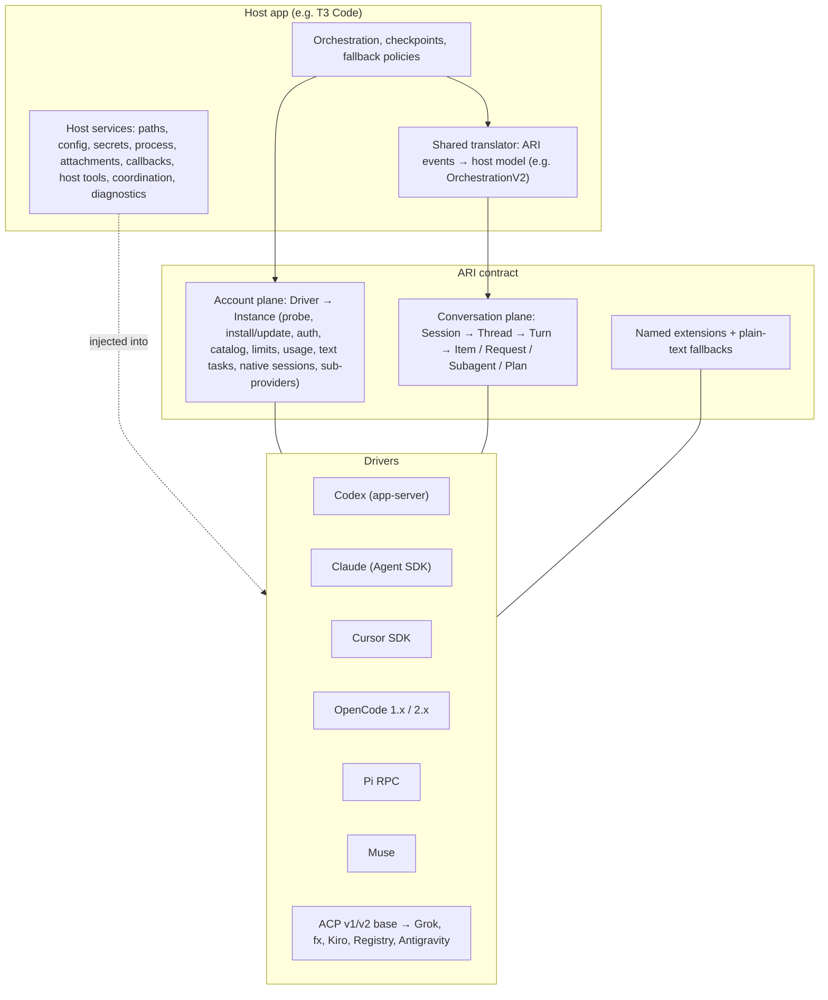

# ARI: a standalone, provider-neutral runtime contract for coding-agent apps

*Proposal originally drafted October 28, 2026; revised November 23, 2026 to incorporate findings from the 14-orchestrator architecture audit (`doc-c03cbe6c`). "ARI" (Agent Runtime Interface) is a working name. ARI is designed to ship as **one standalone npm package with zero runtime dependencies that imports nothing from T3**. T3 Code (audited at commit `be6ff17`, [T3 Tools Inc., 2026a](https://github.com/pingdotgg/t3code/tree/be6ff17f5171c8a55969ec74af46ff1d86666c3a); updated to 11 built-in drivers on `main` as of November 23, 2026, [T3 Tools Inc., 2026f](https://raw.githubusercontent.com/pingdotgg/t3code/main/apps/server/src/provider/builtInDrivers.ts)) is the reference adopter, not a dependency. Packaging is covered in §17–§19, and the mapping from T3's concepts is in Appendix A (§22).*

---

## Short answer

**Yes, one API can cover every feature of all eleven T3 drivers (ten at `be6ff17`, plus `provider-kiro` on `main`)—and the broader orchestrator ecosystem. It can't do that by flattening them.** The design works because of seven choices:

- **It extracts T3's existing contract and hardens it against 14 real orchestrators.** T3's `ProviderAdapterV2` plus its 12-group capability model is already a strong baseline. ARI removes T3's app objects, makes account-level ("control plane") features first-class, shrinks the host interface, and incorporates battle-tested mechanisms proven across `Zeron`, `bb`, `Paseo`, `MonoCode`, `Synara`, `Orca`, `Diri`, `Traycer`, `Emdash`, and `Paradev`: an executable event grammar, 5-state auth with runtime auth poison, idle-process parking and `session.replaced`, authoritative turn settlement (no quiet timers), and three-axis versioning.
- **Each adapter reports only what its provider does natively.** Fallbacks such as steering by interrupt-and-restart, synthetic forks, rollback via filesystem checkpoints, and host-side LLM-judge `auto` approval stay in the host app. That's where T3's capability doc already puts them ([T3 Tools Inc., 2026b](https://github.com/pingdotgg/t3code/blob/be6ff17f5171c8a55969ec74af46ff1d86666c3a/docs/orchestration-v2/provider-capability-system.md)).
- **Native details survive translation.** Native IDs keep a strength rating (strong, weak or none). Native permission and question option IDs are kept exactly, because a display label isn't necessarily a valid reply ([T3 Tools Inc., 2026c](https://github.com/pingdotgg/t3code/blob/be6ff17f5171c8a55969ec74af46ff1d86666c3a/docs/internals/providers.md)). Every request says how it can be answered (live, as a new message, or not resumable). Anything unusual goes into a named extension that carries a plain-text fallback.
- **The update model follows ACP v2, adds an executable grammar, and keeps more.** ACP v2 already moved to upsert-style updates and a separate "accepted" versus "finished" turn signal ([Agent Client Protocol, n.d.-b](https://agentclientprotocol.com/protocol/v2/migration.md)). ARI uses the same durable-upsert + ephemeral-delta split, enforces five runtime lifecycle invariants (`EventGrammar`), and adds what ACP's stable baseline lacks: rollback, queued and steered messages with race protection, yielded background work, goal turns the provider starts on its own, usage limits and reset credits, sign-in handoff and auth poison, model catalogs, install and update handling, and side tasks like commit messages.
- **The host interface is small and doesn't depend on T3.** Today's `ProviderHost` hands every provider T3's whole `ServerSettings` object. ARI's host services give each provider only its own config, namespaced secrets, process spawning with environment rules, attachment lookup, sign-in callback routes and a way to inject the host's tools.
- **It ships as one package any app can use—in-process or over `ari/wire` from Phase 1.** The contract, an optional host toolkit, the conformance kit, the stdio JSON-RPC runner (`ari/wire`), and first-party drivers live in one npm package with subpath exports. It has no runtime dependencies and imports nothing from T3. Vendor SDKs and Effect are optional peer dependencies, loaded only when you import the subpath that needs them (§17). Making `ari/wire` a Phase 1 core target lets Rust/GPUI native hosts (4 of 14 top orchestrators) and crash-isolated JS hosts (`bb`, `Emdash`) adopt ARI drivers on day one.
- **Native drivers for flagship agents; ACP for the long tail.** Across the 9 inspectable open-source structured orchestrators, 8 use native protocols for Claude/Codex/Pi/OpenCode and ACP for the long tail; `Zeron` tried collapsing Claude and Codex onto ACP (deleting ~4,300 lines), hit turn-settlement bugs with background work, and rebuilt native wire drivers ([Zeron, 2026b](https://raw.githubusercontent.com/zeronsh/zeron/main/crates/harness/src/lib.rs); [Zeron, 2026c](https://raw.githubusercontent.com/zeronsh/zeron/main/docs/research/acp.md)).

**This matters for T3 specifically.** Codex, Claude and Antigravity still live inside `apps/server` (even on `main` as of November 23, 2026) because they need app services `ProviderHost` doesn't offer: the secret store, server config, environment identity, a token broker, reset-credit coordination, the attachment store and telemetry. ARI's host interface is written to cover exactly those gaps.

**Not recommended:**
- **Adopting ACP alone for flagship agents.** ACP v2 is still labeled draft ([Agent Client Protocol, n.d.-b](https://agentclientprotocol.com/protocol/v2/migration.md)), session fork is still a proposal (RFD) ([Agent Client Protocol, n.d.-c](https://agentclientprotocol.com/rfds/session-fork.md)), it has no account-level features (`Emdash` went ACP-first and still had to call Claude Agent SDK directly for usage limits), and `Zeron`'s reversal showed adapter-mediated ACP causes turn-settlement regressions.
- **Scraping PTY output to fake a structured chat API.** Coder's `agentapi`, which drove agents through terminal emulation, was archived on Sep 13, 2026 ([Coder, 2026](https://github.com/coder/agentapi)). *Distinction:* offering a separate native terminal/PTY surface alongside ARI for long-tail CLIs or SSH/WSL downgrade (`Orca`, `Emdash`, `Diri`, `Paradev`, `Conductor`) is a valid host pattern; ARI keeps `node-pty` out of core and offers only an optional, zero-dep declarative CLI manifest schema (`ari/cli-manifests`).

**Suggested path for T3, as the reference adopter:** four phases, starting with Pi, the ACP base, and `ari/wire`. Pi is already T3's reference package. T3 keeps a small bridge from ARI to its own orchestration model in its own repo; ARI never depends on T3 (§15). Each phase passes only when the recorded replay fixtures (saved provider sessions T3 replays in tests) produce zero differences in T3's event output.

---

## The package at a glance

| Import | What it is | Runtime dependencies |
|---|---|---|
| `ari` | The contract: types, runtime validators, error types, capability and patch helpers. Browser-safe. | None |
| `ari/host` | Optional host toolkit: event reducer, executable `EventGrammar` validator, request ledger, capability guard, fallback planner, optional `ApprovalReviewer` hook (LLM-judge `auto` mode), replay recorder | None |
| `ari/driver-kit` | Helpers for driver authors: event sequencer, deterministic IDs, JSON-RPC and NDJSON framing, payload truncation helpers | None |
| `ari/node` | Reference host services for Node: paths, process spawning with environment rules, file-backed secrets, atomic managed adapter installer (avoiding `npx -y`) | Node built-ins only |
| `ari/wire` | **Phase 1 core:** JSON-RPC 2.0 stdio transport + `ari-driver <name>` runner (also distributed as standalone OS/arch binaries) + generated Rust/Python/Go client SDKs (§17.11) | None |
| `ari/conformance` | Scenario suite, `EventGrammar` assertions, fixture format and fake host; works with any test runner | None |
| `ari/effect` | Effect bindings: services, streams, tagged errors, generated Effect schemas | Optional peer: `effect` 4.x |
| `ari/drivers/<name>` | First-party drivers: Codex, Claude, Cursor, OpenCode, Pi, Muse, and ACP with Grok, fx, Kiro, Registry and Antigravity | Optional peer: that vendor's SDK, if it has one |
| `ari/meta/<name>` | Browser-safe driver metadata: label, icon, config schema and form hints | None |
| `ari/cli-manifests` | Optional zero-dep declarative CLI launch manifests (`binary`, `envScrubPrefixes`, fresh/resume/fork args, MCP injection) for hosts that offer a native terminal fallback | None |
| `ari/json-schema/*.json` | The wire contract as JSON Schema (draft 2020-12), plus a method table (`methods.json`), for Rust/Go/Python code generation | — |

**What makes it standalone:**
- `dependencies` is empty, and CI fails a release if it isn't.
- Nothing in the package imports, names or assumes T3 or any other host.
- Drivers carry no host prompts, product names or host tool names. The host supplies those at runtime.

---

## 1. What "all their features" means

### 1.1 T3's current provider contract

Any generic layer has to cover at least what T3's adapters already expose. The table lists what the current code defines ([T3 Tools Inc., 2026a](https://github.com/pingdotgg/t3code/blob/be6ff17f5171c8a55969ec74af46ff1d86666c3a/packages/provider-core/src/server/ProviderAdapter.ts)).

| Level | Surface |
|---|---|
| **Driver** | `driverKind`, `metadata` (display name, multiple instances, default instance), `configSchema`, `defaultConfig`, `create`, optional usage reader |
| **Instance** | `snapshot` (status, models, slash commands, skills, usage limits, version advisory, native-session abilities, setup flags); `snapshotForCwd`; `refreshModels`; `invalidateCaches`; `consumeResetCredit`; `textGeneration`; `auth`; `acpSessionManagement` (list, logout, delete session, list/set/disable providers); continuation identity |
| **Adapter** | `getCapabilities`, `planSelectionTransition` (`apply_on_next_turn` / `restart_session` / `create_with_handoff` / `reject`), `openSession` |
| **Session runtime** | `events`, `subscribeEvents`, background-work checks, `getModelContextWindow`, `canReuseContextUsage`, `ensureThread`, `resumeThread`, `injectHistory`, `startTurn`, `compactThread`, `steerTurn`, `stopTask`, `awaitBackgroundTasks`, `interruptTurn`, `stopSubagent`, `unloadThread`, `respondToRuntimeRequest`, `readThreadSnapshot`, `uploadFeedback`, `mcpApps` (list tools, call tool, read resource), `rollbackThread`, `forkThread` |
| **Events** | `app_thread.created`, `provider_session.updated`, `provider_thread.updated` (including `retainedNativeTurnIds`), `provider_turn.updated`, `node.updated`, `subagent.updated`, `message.updated`, `turn_item.updated`, `command_output.delta`, `runtime_request.updated`, `plan.updated`, `turn.terminal` (success, and failure with `childTurnsContinue`) |
| **Capabilities** | 12 groups: sessions, threads, turns, streaming, tools, approvals, planning, subagents, context, checkpointing, identity, runtimePolicy |
| **Requests** | Kinds: `command`, `file-read`, `file-change`, `mcp-elicitation`, `permission`, `dynamic_tool_call`, `user_input`, `auth_refresh`. Decisions: `accept`, `acceptForSession`, `acceptAlways`, `decline`, `cancel`. Response capability: `live` / `message` / `not_resumable` |
| **Policy** | Runtime modes `approval-required`, `auto-accept-edits`, `auto`, `full-access`; interaction modes `default`, `plan`; enforcement `native` or `client-boundary` |
| **Failures** | Classes `usage_limit`, `provider_error`, `transport_error`, `permission_error`, `validation_error`, `unknown`, plus `code`, `retryable`, `resetAt`; retry info (`attempt`, `maxAttempts`, `retryDelayMs`) |

T3's turn-item model has 26 types. About eight are T3 app concepts rather than provider output: `run`, `node`, `fork`, `handoff`, `checkpoint`, `thread_created`, and `run_interrupt_request` / `run_interrupt_result`. Those stay in T3. The rest become ARI item kinds.

Two rules from T3's docs carry straight into ARI:
- **Resuming a thread is required, not a capability.** Every adapter must be able to start from a stored provider handle or return a resume failure ([T3 Tools Inc., 2026b](https://github.com/pingdotgg/t3code/blob/be6ff17f5171c8a55969ec74af46ff1d86666c3a/docs/orchestration-v2/provider-capability-system.md)).
- **A capability left on that fails at runtime is a bug** ([T3 Tools Inc., 2026d](https://github.com/pingdotgg/t3code/blob/be6ff17f5171c8a55969ec74af46ff1d86666c3a/docs/internals/adding-a-provider.md)).

### 1.2 Capability matrix as T3's adapters declare it

**Read this as declared, not measured.** I took the first capabilities object written out in each adapter's source at `be6ff17`. Some values are computed at runtime: the ACP flavors override defaults, and the Grok column was mostly unreadable, so it's left out. Antigravity and fx weren't extracted.

Y = yes, – = no.

| Capability | Codex | Claude | Cursor | OpenCode 1.x | OpenCode 2.x | Pi | Muse | ACP base |
|---|---|---|---|---|---|---|---|---|
| Switch model mid-session | Y | Y | Y | Y | Y | Y | Y | – |
| Switch runtime mode mid-session | Y | – | – | – | Y | – | – | – |
| Read thread snapshot | Y | – | Y | Y | Y | Y | Y | – |
| Roll back thread | Y | Y | – | Y | Y | Y | – | Y |
| Fork thread / fork from a turn | Y/Y | Y/Y | –/– | Y/Y | Y/Y | Y/Y | –/– | –/– |
| Fork from a subagent thread | Y | – | – | Y | – | – | – | – |
| Steer an active turn | Y | Y (stops pending tools) | – | Y | Y | Y | Y | – |
| Steer by interrupt + restart | Y | – | Y | Y | Y | – | – | Y |
| Queued messages / interrupt | Y | Y | Y | Y | Y | Y | Y | Y |
| Streams tool output | Y | – | Y | Y | – | Y | Y | Y |
| Streams plan text | Y | – | Y | – | – | – | – | – |
| MCP tools | Y | Y | Y | Y | – | Y | Y | – |
| Dynamic tool callbacks | Y | Y | – | – | – | – | – | – |
| Command / file-change approval | Y | Y | – | Y | Y | Y | Y | Y |
| File-read approval | Y | Y | – | Y | Y | – | Y | Y |
| Approvals from subagents | Y | – | – | Y | Y | – | Y | – |
| Structured questions | Y | Y | – | Y | Y | Y | Y | Y |
| Todo list / proposed plan | Y/Y | Y/Y | Y/Y | Y/– | –/– | –/– | Y/– | Y/– |
| Subagents / exposes child thread IDs | Y/Y | Y/– | Y/– | Y/Y | Y/Y | Y/– | Y/– | –/– |
| Wait for / close subagents | Y/Y | –/– | Y/– | Y/– | Y/– | –/– | –/– | –/– |
| Accepts system / developer context | Y/Y | Y/Y | –/– | –/– | –/– | –/– | –/– | –/– |
| Can generate summaries | Y | Y | Y | Y | – | – | – | Y |
| Native turn / item / request ID strength | strong/strong/strong | weak/strong/strong | strong/weak/none | weak/strong/strong | weak/strong/strong | weak/strong/strong | strong/strong/strong | weak/weak/weak |
| Policy enforcement | native | native | native | native | native | not in literal | not in literal | client-boundary |

**Takeaways:**
- **No two columns are the same.** A lowest-common-denominator API would lose fork and rollback for 5 of 8 columns and approvals entirely for Cursor.
- **Weak IDs are common.** Cursor reports no native request IDs and only weak item IDs. Several adapters have only weak turn IDs. Identity has to be a first-class part of the model.
- **Enforcement varies.** The ACP base enforces policy only at the client boundary. The API must say so, not imply the provider enforces it.

### 1.3 Provider quirks a generic layer must keep

These are the places where a naive abstraction would quietly break. The last column points to the ARI mechanism, defined in §5–§10.

| Provider | Quirk | ARI mechanism |
|---|---|---|
| **Codex** | Async questions arrive as notifications and are answered with a new user message; there's no pending call to reply to. They stay pending after the turn ends, the provider exits or the server restarts ([T3 Tools Inc., 2026c](https://github.com/pingdotgg/t3code/blob/be6ff17f5171c8a55969ec74af46ff1d86666c3a/docs/internals/providers.md)). | `Request.response = {mode:"message"}`, `survivesRestart: true` |
| **Codex** | `/goal` starts the next turn on its own milliseconds after the last one finishes, so one host run can own several native turns ([T3 Tools Inc., 2026c](https://github.com/pingdotgg/t3code/blob/be6ff17f5171c8a55969ec74af46ff1d86666c3a/docs/internals/providers.md)). | `turn.origin = "provider_initiated"`; `turns.multiNativeTurnsPerRequest`; shared `ari.goal` extension |
| **Codex** | Calls seen in T3's adapter include `turn/steer`, `thread/fork`, `thread/compact/start`, `thread/goal/{set,get,clear}`, `thread/backgroundTerminals/{list,terminate}`, `feedback/upload`, `model/rerouted`, `account/rateLimits/updated`, `mcpServer/tool/call`, `mcpServer/resource/read` ([T3 Tools Inc., 2026a](https://github.com/pingdotgg/t3code/blob/be6ff17f5171c8a55969ec74af46ff1d86666c3a/apps/server/src/orchestration-v2/Adapters/CodexAdapterV2.ts)). The app-server README also documents many experimental features, such as `thread/memory/read`, thread read state and `userVerification/cancel` ([OpenAI, n.d.](https://raw.githubusercontent.com/openai/codex/main/codex-rs/app-server/README.md)). | Core: steer, fork, compact, background tasks, MCP apps, feedback, limits. Extensions: `codex.goal`, `codex.readState`, `codex.memory` |
| **Codex** | T3 opts out of `turn/diff/updated` because it computes diffs from its own checkpoints ([T3 Tools Inc., 2026c](https://github.com/pingdotgg/t3code/blob/be6ff17f5171c8a55969ec74af46ff1d86666c3a/docs/internals/providers.md)). | `SessionOptions.emitDiffs: false`; checkpoints belong to the host |
| **Codex** | Managed ChatGPT sign-in for a remote environment can finish on a local primary machine, which then hands the credentials over. Only the destination may refresh the session ([T3 Tools Inc., 2026c](https://github.com/pingdotgg/t3code/blob/be6ff17f5171c8a55969ec74af46ff1d86666c3a/docs/internals/providers.md)). | `auth.transferProfile`; `callbacks` host service; credential binding |
| **Claude** | The Agent SDK runs through `query()`, which returns a `Query` stream ([Anthropic, n.d.](https://docs.claude.com/en/docs/agent-sdk/typescript)). T3 uses `canUseTool`, `forkSession`, `resumeSessionAt`, `hooks`, `agents`, `effort`/`thinking`, and the control methods `setPermissionMode`, `setModel`, `applyFlagSettings`, `setMcpServers`, `stopTask`, `readFile`, `interrupt` ([T3 Tools Inc., 2026a](https://github.com/pingdotgg/t3code/blob/be6ff17f5171c8a55969ec74af46ff1d86666c3a/apps/server/src/orchestration-v2/Adapters/ClaudeAdapterV2.ts)). | Core: requests, fork-at-turn, model/policy changes, MCP config, stop task. Extensions: `claude.hooks`, `claude.fileCheckpoints` |
| **Claude** | SDK mode emits no goal events; T3 reads goal state from command output and Stop-hook feedback in the transcript ([T3 Tools Inc., 2026c](https://github.com/pingdotgg/t3code/blob/be6ff17f5171c8a55969ec74af46ff1d86666c3a/docs/internals/providers.md)). | Same shared `ari.goal` extension as Codex, marked as derived rather than native |
| **Claude** | Active steering stops pending tools (`activeSteeringInterruptsTools: true` in T3's declaration). | `turns.steeringInterruptsTools` |
| **Cursor** | T3 declares no fork, no rollback, no active steering and no approvals. The adapter rejects fork and rollback with explicit "unsupported" errors (per T3 adapter). | Honest capabilities; the host decides fallbacks |
| **OpenCode** | T3 picks the 1.x or 2.x runtime by version. 1.x runs one server per thread; 2.x runs one server per instance. MCP registrations are per directory while T3's are per thread, so 2.x adds a `t3-code-<thread>` entry and deny rules for every other thread's entry ([T3 Tools Inc., 2026c](https://github.com/pingdotgg/t3code/blob/be6ff17f5171c8a55969ec74af46ff1d86666c3a/docs/internals/providers.md)). | `sessionModel`, `mcp.scope = "directory"`, host tool injection per thread |
| **OpenCode** | "Always" approvals apply to the whole project, so T3's automatic full-access replies use "once" so a shared server can't widen a supervised thread's permissions. External servers stay externally owned ([T3 Tools Inc., 2026c](https://github.com/pingdotgg/t3code/blob/be6ff17f5171c8a55969ec74af46ff1d86666c3a/docs/internals/providers.md)). | Each option states its real reach (`scope: "project"`); adapters must not widen beyond the requested scope; `externallyOwned` flag |
| **Pi** | T3 runs the user's own `pi` install in RPC mode and injects only its namespaced MCP bridge. Pi's session files back resume, rollback and forks. Forks use Pi's CLI in the destination directory because switching sessions over RPC keeps the old working directory ([T3 Tools Inc., 2026c](https://github.com/pingdotgg/t3code/blob/be6ff17f5171c8a55969ec74af46ff1d86666c3a/docs/internals/providers.md)). | Fork options include `cwd`; host tool injection; native fork stays inside the adapter |
| **Muse** | Talks over its own JSON-RPC protocol (`session/start`, `turn/steer`, `approval/decide`, `userInput/answer`); T3 declares no fork or rollback (per T3 adapter). | Core turn, steer and request mapping |
| **ACP agents** | v1 vs v2 differ. In v2 the prompt response only means "accepted" and completion arrives in `state_update`; updates are upserts; client filesystem, terminal and modes APIs are gone ([Agent Client Protocol, n.d.-b](https://agentclientprotocol.com/protocol/v2/migration.md)). Fork is an RFD that may reject a different working directory ([Agent Client Protocol, n.d.-c](https://agentclientprotocol.com/rfds/session-fork.md)). | Version-aware ACP adapter; fork constraints in capabilities |
| **ACP agents** | fx is reported to offer several model-category config options (provider, then model), and Antigravity permission prompts are reported to reject custom answers. *(Both from a research sub-agent citing T3 issues; not re-verified.)* | `ConfigOption.dependsOn`; `allowCustomAnswer: false`; reply by option ID |
| **Antigravity** | Can checkpoint the workspace but can't roll back its conversation, so revert is rejected before touching files. Each instance gets its own account profile with file-based credentials, and ambient Google credentials are stripped. The installer leases versions to running processes ([T3 Tools Inc., 2026c](https://github.com/pingdotgg/t3code/blob/be6ff17f5171c8a55969ec74af46ff1d86666c3a/docs/internals/providers.md)). | Checkpoint capabilities; `process.envPolicy`; per-instance paths; maintenance leases |
| **All** | Setup must never happen as a side effect of a health check: opening a session can start MCP servers, run hooks or launch a sign-in browser ([T3 Tools Inc., 2026c](https://github.com/pingdotgg/t3code/blob/be6ff17f5171c8a55969ec74af46ff1d86666c3a/docs/internals/providers.md)). | `probe()` must have no side effects, and conformance tests check it |

---

## 2. Should there be one generic layer at all?

### Arguments for
1. **The abstraction already exists—eight times over, just not as one shared standalone contract.** T3 has eleven built-in drivers on `main` (ten at `be6ff17`, plus `provider-kiro`), a capability system, and `provider-core` ([T3 Tools Inc., 2026d](https://github.com/pingdotgg/t3code/blob/be6ff17f5171c8a55969ec74af46ff1d86666c3a/docs/internals/adding-a-provider.md); [T3 Tools Inc., 2026f](https://raw.githubusercontent.com/pingdotgg/t3code/main/apps/server/src/provider/builtInDrivers.ts)). Across the 14-orchestrator audit (`doc-c03cbe6c`), `bb`, `Zeron`, `Paseo`, `MonoCode`, `Synara`, `Paradev`, and `Traycer` all built parallel internal provider contracts—yet none is published as a zero-dependency, host-neutral package.
2. **It unblocks moving Codex, Claude and Antigravity into packages.** Their blockers are host services, not protocol translation (§9–§10).
3. **Testing gets simpler.** One conformance kit with executable grammar invariants can check every claimed capability against replay fixtures.
4. **ACP is moving the same way—but isn't enough on its own.** v2 adopts upserts, accepted-vs-finished turns, forward-compatible enums, subagent sessions as part of the baseline, and session config options ([Agent Client Protocol, n.d.-b](https://agentclientprotocol.com/protocol/v2/migration.md); [Agent Client Protocol, n.d.-d](https://agentclientprotocol.com/rfds/subagents.md)). At the same time, `Zeron` tried moving Claude and Codex to ACP (deleting ~4,300 lines) and reversed back to native wire drivers after hitting turn-settlement bugs ([Zeron, 2026b](https://raw.githubusercontent.com/zeronsh/zeron/main/crates/harness/src/lib.rs); [Zeron, 2026c](https://raw.githubusercontent.com/zeronsh/zeron/main/docs/research/acp.md)), `Paseo` RFC #1042 declined to collapse ~10k lines of bespoke adapters into ACP, and `Emdash` had to bypass ACP to probe Claude usage limits directly ([Emdash, 2026a](https://github.com/generalaction/emdash)).
5. **Third parties—and non-JS native hosts—can adopt drivers** without depending on T3 internals, either in-process or over `ari/wire`.

### Arguments against
1. **There's a pull toward the lowest common denominator.** Terminal-to-chat scraping (`agentapi`) was archived ([Coder, 2026](https://github.com/coder/agentapi)). ACP's own fork proposal says it was modeled on the Claude SDK and "must be validated against other agents" ([Agent Client Protocol, n.d.-c](https://agentclientprotocol.com/rfds/session-fork.md)).
2. **The mismatches are about meaning, not syntax.** Questions answered by message, goal runs spanning several turns, project-wide approvals, duplicate `allow_always` options, and per-directory MCP each need a typed escape hatch. An API that hides them causes exactly the bugs T3 and Zeron already document.
3. **Vendors move faster than a spec.** The Codex app-server README alone carries many experimental features ([OpenAI, n.d.](https://raw.githubusercontent.com/openai/codex/main/codex-rs/app-server/README.md)).
4. **Two translations instead of one.** Native → ARI → host means more latency and more places to debug.
5. **Ownership and adoption gravity.** Eight teams built their own contracts in 2026 because fast-moving product teams want to patch a broken vendor adapter in 10 minutes in-repo rather than wait on an upstream release (§18).

### Alternatives compared

| Option | Keeps features | Loose coupling | Cost | Verdict |
|---|---|---|---|---|
| A. Status quo: each adapter emits T3 orchestration types | Full | Low: adapters depend on T3's domain model and host | Low now, rising | Works today; blocks extraction and reuse |
| B. Adopt ACP (v1 and v2) as the only layer | Partial: no rollback, steer/queue, goals, limits, sign-in handoff, catalog or install handling in the stable baseline; `Zeron` reversed an ACP-only migration for Claude/Codex | High | Medium; Codex and Claude need ACP wrappers | Use as a transport for ground-up ACP agents, not as the sole contract |
| C1. Scraping PTY output to simulate a structured chat API (`agentapi`) | Poor | High | Low | Rejected; the archived prior art shows why |
| C2. Native terminal/PTY surface alongside ARI (`Orca`, `Emdash`, `Diri`, `Paradev`, `Conductor`) | Full CLI coverage, no structured chat semantics | High | Low for hosts | Valid companion surface in host apps; keep `node-pty` out of ARI core and offer optional `ari/cli-manifests` |
| D. ARI: a superset with ACP-v2-style updates, an executable grammar, an account-level plane, a small host interface, `ari/wire`, and extensions | Full, via core plus extensions | High | Medium; mostly extracting what exists | **Recommended** |

---

## 3. Design principles

1. **Lossless.** Every native feature fits in the core API or in a typed extension. Nothing is flattened into text.
2. **Honest capabilities, fallbacks in the host.** An adapter never fakes a feature silently. Unsupported calls return `unsupported{capability}`, and the host applies T3's fallback policies.
3. **Provider concepts only.** No app threads, runs, execution nodes or checkpoints in the API. T3 keeps one shared ARI → OrchestrationV2 translator.
4. **Identity is first-class.** Every entity carries a deterministic ID plus a native reference with a strength rating.
5. **Forward-compatible.** Unknown enum values and union variants are tolerated, and patches follow ACP v2 rules (omitted = unchanged, `null` = cleared) ([Agent Client Protocol, n.d.-b](https://agentclientprotocol.com/protocol/v2/migration.md)).
6. **Small host interface.** A provider sees only its own config and namespaced services, never host-wide settings.
7. **Side-effect-free probes.**
8. **Transport-neutral.** The same schema works in-process (plain TypeScript, no Effect required) or over JSON-RPC. That means no callbacks inside host-service contracts that can't be serialized.

---

## 4. Architecture



| Layer | Owns | Not its job |
|---|---|---|
| **Driver** | Metadata, config schema, building instances | Long-lived state |
| **Instance** (one config + account) | Install state, sign-in, catalog, limits, usage history, text side tasks, native session list, sub-providers, continuation key | Conversations |
| **Session** (one process or connection) | Capabilities, config options, event stream, thread and turn operations | Fallback policy |
| **Host** | Orchestration, queueing when the provider has no native queue, filesystem checkpoints and diffs, cross-provider handoff, persistence | Translating native protocols |

---

## 5. Core model

### 5.1 Identity

```ts
type RefStrength = "strong" | "weak" | "none";
interface NativeRef {
  id: string | null;          // the provider's own id, if any
  strength: RefStrength;      // strong: use as-is; weak: plus ordinal/fingerprint; none: allocate by ordinal
  fingerprint?: string;
  ordinal?: number;
}
// Every ARI entity id is an adapter-stable string that MUST be deterministic
// from native data (same native input → same id across restart/replay).
// `identityVersion` lets an adapter change its derivation without breaking
// persisted history (T3 already passes initialProviderItemIdentityVersion).
```

The three strengths reproduce T3's existing correlation rules ([T3 Tools Inc., 2026b](https://github.com/pingdotgg/t3code/blob/be6ff17f5171c8a55969ec74af46ff1d86666c3a/docs/orchestration-v2/provider-capability-system.md)).

### 5.2 Event envelope

```ts
interface AriEvent {
  seq: number;                 // monotonic, gap-free per session; enables catch-up
  at: string;                  // ISO-8601
  sessionId: string;
  threadId?: string;
  turnId?: string;
  hostTag?: string;            // opaque value the host passed on startTurn, echoed back
  body: AriEventBody;
  native?: { method?: string; payload?: unknown }; // bounded raw frame, diagnostics only
}

type AriEventBody =
  | { type: "session.state"; state: "starting"|"ready"|"running"|"waiting"|"stopped"|"error"; failure?: Failure }
  | { type: "session.replaced"; previousNativeId?: string; reason: string; contextLost: boolean; showRuntimeNote?: boolean }
  | { type: "capabilities.updated"; capabilities: Capabilities }
  | { type: "config.updated"; options: ConfigOption[] }
  | { type: "commands.updated"; commands: SlashCommand[]; skills?: Skill[] }
  | { type: "thread.upsert"; thread: Patch<Thread>; retainedNativeTurnIds?: string[] }
  | { type: "turn.upsert"; turn: Patch<Turn> }          // Turn.origin: "user" | "provider_initiated"
  | { type: "item.upsert"; item: Patch<Item> }          // durable state
  | { type: "item.delta"; itemId: string; field: "text"|"reasoning"|"output"|"plan"; chunk: string; stream?: "stdout"|"stderr" }  // ephemeral streaming delta
  | { type: "request.upsert"; request: Patch<Request> }
  | { type: "subagent.upsert"; subagent: Patch<Subagent> }
  | { type: "plan.upsert"; plan: Patch<Plan> }
  | { type: "background.updated"; tasks: BackgroundTaskSummary[] }  // yielded-but-alive background work; empty once back in foreground
  | { type: "usage.updated"; usage: UsageSnapshot }      // tokens, cost, context used/max
  | { type: "limits.updated"; limits: LimitStatus }
  | { type: "notice"; level: "info"|"warning"|"error"; code?: string; text: string }
  | { type: "retry"; attempt: number; maxAttempts: number|null; retryDelayMs: number|null }
  | { type: "turn.terminal"; turnId: string;
      status: "completed"|"interrupted"|"cancelled"|"failed";
      failure?: Failure;
      threadDisposition: "reusable"|"broken";
      childTurnsContinue?: boolean }                     // children outlive a failed root
  | { type: `x:${string}`; data: unknown; fallback?: { title: string; text?: string } };
```

`Patch<T>` follows ACP v2: an omitted field is unchanged, `null` clears it, a value replaces it, and text chunks append ([Agent Client Protocol, n.d.-b](https://agentclientprotocol.com/protocol/v2/migration.md)). `retainedNativeTurnIds` and `childTurnsContinue` are kept from T3's current events, because T3's translator uses them to reconcile after rollback and to settle child turns.

**Event durability, grammar, settlement, and payload bounds:**
- **Durable vs ephemeral split.** Every `*.upsert`, `session.replaced`, `background.updated`, and `turn.terminal` event is **durable** (persisted by host journals); `item.delta` is **ephemeral** and may be coalesced or discarded once the enclosing `item.upsert` settles, following `Paradev`'s `@superset/chat` split ([Paradev, 2026a](https://github.com/ParadevAI/Paradev)).
- **Executable `EventGrammar` invariants.** Modeled on `bb`'s `ThreadEventGrammar` ([bb, 2026c](https://raw.githubusercontent.com/get-bb/bb/main/packages/provider-bridge-protocol/src/thread-event-grammar.ts)), every session stream MUST satisfy five invariants plus monotonic gap-free `seq`: `item/opens-before-delta` (no `item.delta` before its `item.upsert`), `item/settles-once`, `turn/starts-once`, `turn/settles-once`, and `turn/known`. `ari/conformance` runs `EventGrammar` in fail-hard `strict` mode; `ari/host` exposes `strict | warn | repair` modes so live hosts aren't crashed by a vendor regression.
- **Authoritative turn settlement (no quiet timers).** Drivers MUST NOT synthesize `turn.terminal` from an inactivity/quiet timer. Pending turns settle only on authoritative provider completion, explicit cancel, or process exit (with a brief notification-drain grace window before emitting `turn.terminal`). `Zeron` retired its 30-second quiet timer after real slow-model sessions showed legitimate 36.6–36.8-second post-tool pauses, causing overlapping prompt races ([Zeron, 2026c](https://raw.githubusercontent.com/zeronsh/zeron/main/docs/research/acp.md)). When an agent yields control while started background work is still running and will wake it again, the driver emits `background.updated` instead of faking completion ([MonoCode, 2026b](https://raw.githubusercontent.com/hardbeat920/monocode/main/src/integrations/harness/core/types.ts)).
- **`session.replaced` on fallback.** When a driver cannot resume a locked or missing native session (for example Devin CLI returning `-32015 "already open in another process"`, [Zeron, 2026c](https://raw.githubusercontent.com/zeronsh/zeron/main/docs/research/acp.md)) and falls back to a fresh session, it MUST emit `session.replaced` with `contextLost: true` rather than silently swapping IDs ([bb, 2026e](https://raw.githubusercontent.com/get-bb/bb/main/packages/provider-bridge-protocol/src/notifications.ts)).
- **Bounded ingress and payload caps.** Drivers respect `SessionOptions.payloadLimits` (`maxToolOutputBytes`, `maxDiffBytes`), setting `truncated: true` on capped item payloads (e.g., `Zeron` caps harness tool output/diffs at 16 KB / 64 KB; `Synara` runs a 2,048-event bounded ingress queue with backpressure and byte-size compaction) ([Zeron, 2026c](https://raw.githubusercontent.com/zeronsh/zeron/main/docs/research/acp.md); [Synara, 2026b](https://raw.githubusercontent.com/Emanuele-web04/synara/main/packages/contracts/src/providerRuntime.ts)).

### 5.3 Items

```ts
type ItemKind =
  | "user_message" | "assistant_message" | "reasoning"
  | "command_execution" | "file_change" | "file_read" | "file_search" | "web_search"
  | "mcp_tool_call" | "dynamic_tool_call" | "tool_call"      // tool_call = generic fallback
  | "todo_list" | "proposed_plan" | "compaction" | "review" | "image"
  | "subagent_spawn" | "system_notice" | "error"
  | `x:${string}`;

interface Item {
  id: string; kind: ItemKind; native: NativeRef;
  status: "pending"|"running"|"waiting"|"completed"|"failed"|"cancelled"|"interrupted";
  parentItemId?: string; title?: string; startedAt?: string; completedAt?: string;
  truncated?: boolean;  // true when tool output or diff hit SessionOptions.payloadLimits
  hostMeta?: unknown;   // echoed host metadata on user messages (e.g., creator, scheduled-task id)
  // kind-specific payload: text, command/cwd/exitCode, file diffs (if emitDiffs), tool {server,name,input,result}, ...
}
```

---

## 6. Conversation plane

```ts
interface LaunchContext {
  // Ephemeral launch-only injections — drivers MUST NOT persist these into native provider configs
  appendSystemPrompt?: string[];
  developerPrompt?: string[];
  mcpServers?: (McpServerConfig & { alwaysLoad?: boolean })[];  // alwaysLoad prevents tool-search deferral
  dynamicTools?: DynamicToolSpec[];                              // optional non-MCP inbound item/tool/call
}

interface Session {
  readonly id: string;
  capabilities(): Capabilities;
  events(opts?: { fromSeq?: number }): AsyncIterable<AriEvent>;   // replayable from a sequence number

  // Threads (resumeThread is REQUIRED; everything else is gated by capabilities)
  createThread(i: { cwd: string; config?: ConfigValues; policy: RuntimePolicy;
                    launch?: LaunchContext; title?: string; forceNew?: boolean;
                    persistSession?: boolean;                      // false for ephemeral side tasks (default true)
                    context?: { system?: string; developer?: string } }): Promise<Thread & { appliedConfig?: ConfigValues }>;
  resumeThread(i: { native: NativeRef | { handle: string }; config?: ConfigValues; policy?: RuntimePolicy;
                    launch?: LaunchContext;
                    purpose?: "interactive" | "history";           // "history" = read-only transcript load without live runtime
                    quiet?: boolean }): Promise<Thread & { appliedConfig?: ConfigValues }>; // quiet skips replaying stored items
  readSnapshot?(threadId: string): Promise<ThreadSnapshot>;       // thread, turns, items, requests, nativePayload?
  forkThread?(i: { threadId: string; at: { type:"latest" } | { type:"turn"; turnId: string } | { type:"item"; itemId: string };
                   cwd?: string; config?: ConfigValues; policy?: RuntimePolicy }): Promise<Thread>;
  rollbackThread?(i: { threadId: string; to: { type:"start" } | { type:"turn"; turnId: string } }): Promise<ThreadSnapshot>;
  compactThread?(threadId: string): Promise<void>;
  injectHistory?(i: { threadId: string; messages: HistoricalMessage[]; summary: string }): Promise<{ consumed: boolean }>;
  unloadThread?(threadId: string): Promise<void>;

  // Idle process parking (distinct from interruptTurn / close)
  canRelease(): boolean;                                          // veto when background tasks, pending requests, or unpersisted state exist
  release(): Promise<void>;                                       // parks/releases runtime resources without destroying the thread

  // Turns
  startTurn(i: {
    threadId: string;
    clientTurnKey: string;                       // idempotency key; a retry must not double-send
    intent: "start" | "queue" | "steer";
    expectedTurnId?: string;                     // for steer: prevents steering the wrong turn across a boundary race
    clearPendingPermissions?: boolean;           // for steer: deny blocking permissions before steering
    content: ContentBlock[];                     // text | image | file{attachmentRef} | resource_link
    context?: { system?: string; developer?: string; synthetic?: { key: string; text: string }[] };
    config?: ConfigValues;                       // per-turn: model, effort, ...
    policy?: RuntimePolicy;
    hostTag?: string;                            // echoed on every event of this turn
  }): Promise<
    | { status: "accepted"; turnId: string; accepted: "started" | "queued" | "steered"; providerMessageId?: string }
    | { status: "prompt_required" }              // steer arrived after turn ended; host must send a normal "start" turn
    | { status: "unsupported"; capability: string }
  >;
  interruptTurn(i: { turnId: string; restartRuntime?: boolean }): Promise<void>;

  // Requests (approvals, questions, elicitation, sign-in refresh, dynamic tools)
  respond(i: { requestId: string; responseKey: string;     // idempotent
               optionId?: string; answers?: Record<string, Answer>;
               feedback?: string; custom?: string; scope?: ApprovalScope }): Promise<{ followUpPrompt?: ContentBlock[] } | void>;

  // Background work and subagents
  backgroundTasks?: {
    list(threadId: string, opts?: { includeSubagents?: boolean }): Promise<TaskInfo[]>;
    stop(i: { threadId: string; taskId: string }): Promise<void>;
    await(i: { threadId: string; taskIds: string[]; awaited: boolean }): Promise<{ matched: string[] }>;
  };
  stopSubagent?(i: { subagentId: string; requestedAt?: string }): Promise<SubagentOutcome | void>;
  // requestedAt guards a race: a delayed stop must not kill a task resumed after the request

  // MCP apps (thread-scoped)
  mcpApps?: { listTools(threadId: string, server: string): Promise<McpTool[]>;
              callTool(threadId: string, server: string, tool: string, args: object): Promise<McpCallResult>;
              readResource(threadId: string, server: string, uri: string): Promise<{ contents: unknown[] }> };

  // Config and model changes
  planConfigChange(i: { threadId: string; changes: ConfigValues }):
    Promise<{ type: "apply_next_turn" } | { type: "apply_now" } | { type: "restart_session" }
          | { type: "new_thread_with_handoff" } | { type: "reject"; reason: string }>;
  contextWindow?(model: string, cwd?: string): number | undefined;
  canReuseContextUsage?(previousModel: string, nextModel: string): boolean;

  uploadFeedback?(i: { threadId: string; reason?: string }): Promise<{ feedbackId: string }>;
  ext?(ns: string, method: string, params: unknown): Promise<unknown>;   // named extensions
  close(): Promise<void>;
}
```

**Steering, parking, launch hygiene, and host-side Auto approval:**
- **Race-safe steering.** Steering is an intent on `startTurn`, not a separate method. Passing `expectedTurnId` and `clearPendingPermissions` prevents steering the wrong turn or deadlocking on a pending approval ([Paseo, 2026b](https://raw.githubusercontent.com/getpaseo/paseo/main/packages/server/src/server/agent/agent-sdk-types.ts)). If the active turn finishes milliseconds before a steer arrives, the driver returns `{ status: "prompt_required" }` rather than silently starting an untracked turn (matching `codex-acp`'s `idleBehavior: "promptRequired"` and `Paradev`'s `steer() -> false`, [Paradev, 2026b](https://raw.githubusercontent.com/ParadevAI/Paradev/main/packages/chat-runtime/src/harness/types.ts)). If the provider cannot steer, it returns `{ status: "unsupported" }`, and the host applies its own fallback or calls `planFallback()` in `ari/host`.
- **Idle-process parking.** Multi-worktree hosts run 5–10+ parallel threads. `canRelease()` + `release()` let hosts park idle runtimes (like `MonoCode`'s 3-minute idle park and `Paseo`'s 1-hour GC with `canStopRuntime()` vetoes) without destroying thread state or killing background work ([MonoCode, 2026c](https://raw.githubusercontent.com/hardbeat920/monocode/main/src/integrations/harness/core/registry.ts); [Paseo, 2026b](https://raw.githubusercontent.com/getpaseo/paseo/main/packages/server/src/server/agent/agent-sdk-types.ts)).
- **Ephemeral `LaunchContext` & effective selections.** Host prompts and MCP server injections live in `LaunchContext` and are never written into native provider config files so setting changes take effect cleanly; `alwaysLoad: true` prevents Claude/supporting providers from deferring host orchestration tools behind tool search ([Paseo, 2026b](https://raw.githubusercontent.com/getpaseo/paseo/main/packages/server/src/server/agent/agent-sdk-types.ts)). `createThread` and `resumeThread` return `appliedConfig` (effective model/effort/mode after provider clamping).
- **Optional host-side `ApprovalReviewer` (`ari/host`).** Where a provider lacks a native `auto` classifier, hosts like `Traycer` and `bb` evaluate incoming requests with a host-side LLM judge / restrict-only repo policy and audit log ([Traycer, 2026a](https://github.com/traycerai/traycer); [bb, 2026b](https://raw.githubusercontent.com/get-bb/bb/main/packages/provider-bridge-protocol/src/handshake.ts)). ARI offers an optional `ApprovalReviewer` hook in `ari/host`, never hidden inside drivers.

### 6.1 Config options and runtime policy

```ts
interface ConfigOption {
  id: string;
  category: "model"|"reasoning"|"mode"|"permission"|"provider"|"other"|`x:${string}`;
  label: string;
  type: "select"|"boolean"|"text"|"number";
  values?: { id: string; label: string; description?: string; badge?: string }[];
  current: unknown;
  scope: "instance"|"session"|"thread"|"turn";
  dependsOn?: string[];                // e.g. fx: provider select → model select
  changeEffect: "next_turn"|"immediate"|"restart_session"|"new_thread";
}

interface RuntimePolicy {
  mode: "read_only"|"approval_required"|"auto_accept_edits"|"auto"|"full_access";
  interaction: "default"|"plan";
  cwd: string;
  additionalRoots?: string[];
  native?: unknown;   // opaque provider-native policy, passed through (e.g., Codex sandbox, OpenCode ruleset)
}
```

ARI defines five runtime modes (`read_only` added for review/audit/explore threads, matching `MonoCode`'s `AccessMode::ReadOnly` and `Synara`'s `"read-only"` sandbox mode; [MonoCode, 2026a](https://github.com/hardbeat920/monocode)) and two interaction modes. T3's four existing modes map one-to-one ([T3 Tools Inc., 2026a](https://github.com/pingdotgg/t3code/blob/be6ff17f5171c8a55969ec74af46ff1d86666c3a/packages/contracts/src/providerPolicy.ts)). Each adapter declares, for each mode, whether the provider enforces it natively or only at the client boundary. Config options are modeled on ACP's session config options; ACP v2 replaced its separate "modes" with these ([Agent Client Protocol, n.d.-b](https://agentclientprotocol.com/protocol/v2/migration.md)).

---

## 7. Capabilities

ARI groups its capabilities into the same 12 groups T3 uses (sessions, threads, turns, streaming, tools, approvals, planning, subagents, context, checkpointing, identity, runtimePolicy), so T3's values carry over directly ([T3 Tools Inc., 2026b](https://github.com/pingdotgg/t3code/blob/be6ff17f5171c8a55969ec74af46ff1d86666c3a/docs/orchestration-v2/provider-capability-system.md)). The definitions live in ARI, not in T3. ARI adds these:

| Addition | Why it's needed |
|---|---|
| `requests.responseModes` (`live`/`message`/`not_resumable`), `requests.allowCustomAnswer`, `requests.approvalScopes` with the real reach of each scope | Codex questions answered by message; Antigravity fixed-choice prompts; OpenCode's project-wide "always" |
| `threads.fork: { fromTurn, fromItem, fromSubagent, crossCwd }` | ACP fork may reject a different working directory ([Agent Client Protocol, n.d.-c](https://agentclientprotocol.com/rfds/session-fork.md)); Pi needs special handling for forks into another directory |
| `turns.multiNativeTurnsPerRequest`, `turns.steeringInterruptsTools` | Codex goals; Claude steering |
| `background: { list, stop, await, tasksEndWithProcess }` | Codex background terminals; Claude `stopTask` |
| `mcp: { acceptsHostServers: ("stdio"\|"http"\|"sse")[]; scope: "thread"\|"directory"\|"session" }` | OpenCode's per-directory MCP registrations |
| `sessionModel: "in_process"\|"process_per_thread"\|"process_per_instance"\|"external"` + `externallyOwned` | OpenCode 1.x vs 2.x; external OpenCode servers |
| `diffs: { emits: boolean; canDisable: boolean }` | Hosts that compute diffs from their own checkpoints, as T3 does, can turn provider diffs off |
| `context.instructionChannels: ("system"\|"developer"\|"first_user_message")[]` | Hosts pass their own instructions at runtime instead of drivers bundling a host's prompt. T3's drivers currently inject T3's orchestration prompt themselves ([T3 Tools Inc., 2026a](https://github.com/pingdotgg/t3code/blob/be6ff17f5171c8a55969ec74af46ff1d86666c3a/packages/provider-core/src/server/orchestrationInstructions.ts)) |
| `contextWindowReporting`, `extensions: { ns, version }[]`, `ariVersion` | Discovery |

Capabilities can change mid-session through `capabilities.updated`, for example after ACP sends new config options or after sign-in. They're versioned and emitted at session start, as T3's doc already requires.

---

## 8. Requests: approvals, questions, elicitation

```ts
interface Request {
  id: string; native: NativeRef;
  kind: "command"|"file_read"|"file_change"|"permission"|"mcp_elicitation"
      |"user_input"|"dynamic_tool_call"|"auth_refresh"|`x:${string}`;
  origin: { threadId: string; turnId?: string; itemId?: string; subagentId?: string };
  subject?: { command?: string[]; cwd?: string; paths?: string[]; diff?: string;
              tool?: { server?: string; name: string; input: unknown } };
  options?: { optionId: string;           // native, opaque: reply with this, never the label
              label: string;
              decision: "accept"|"accept_for_session"|"accept_always"|"decline"|"cancel"|"other";
              scope?: "once"|"session"|"project"|"global";   // the scope's REAL reach on this provider
              warning?: string }[];
  questions?: Question[];                 // single/multi-select, text, secret, url; native ids kept
  allowCustomAnswer: boolean;
  allowFeedback: boolean;
  response: { mode: "live" } | { mode: "message" } | { mode: "not_resumable"; reason: string };
  survivesRestart: boolean;
  status: "pending"|"resolved"|"expired"|"cancelled";
  fullAccessOverride?: "ask_rule"|"provider_check";   // why it still reached the user under full access
}
```

**Safety rules:**
1. **Never widen permissions.** An adapter must not grant broader scope than the host asked for. When the policy is `full_access` and the host auto-replies, the adapter uses the narrowest option. This is how T3 already handles OpenCode ([T3 Tools Inc., 2026c](https://github.com/pingdotgg/t3code/blob/be6ff17f5171c8a55969ec74af46ff1d86666c3a/docs/internals/providers.md)).
2. **Responses are idempotent** by `(requestId, responseKey)`. This mirrors T3's `runtime-request.respond` receipt behavior. Resolving a plan approval may return `{ followUpPrompt }` when the host must send a follow-up turn to start execution ([Paseo, 2026b](https://raw.githubusercontent.com/getpaseo/paseo/main/packages/server/src/server/agent/agent-sdk-types.ts)).
3. **`message`-mode requests are answered by the host** sending a normal user message. The adapter only links the answer to the request.
4. **Requests that can't survive a restart** move to `expired` or `not_resumable` when their session ends. Hosts must not treat a request as gone just because it isn't in the latest event window.
5. **Question-shaped detection must not rely on duplicate option kinds.** Codex sends two `allow_always` options on every exec approval ("Allow for Session" plus a prefix-rule amendment); an adapter classifies a permission request as question-shaped only when at least one option lacks an allow/reject decision kind ([Zeron, 2026c](https://raw.githubusercontent.com/zeronsh/zeron/main/docs/research/acp.md)).

---

## 9. Account plane: driver and instance

```ts
interface Driver<C> {
  kind: string; ariVersion: string;
  metadata: { displayName: string; icon?: Icon; docsUrl?: string;
              multipleInstances: boolean; hasDefaultInstance: boolean };
  configSchema: JSONSchema; defaultConfig(): C;
  cliManifest?: CliLaunchManifest;      // optional zero-dep descriptor for host terminal fallback (binary, args, envScrub)
  create(host: HostServices, i: { instanceId: string; config: C; displayName?: string;
                                  environment: Record<string, string> }): Promise<Instance>;
}

type AuthStatus = "authenticated" | "configured" | "unauthenticated" | "unknown" | "unavailable";
interface AuthState {
  status: AuthStatus;                   // only "unauthenticated" blocks Send; "configured" & "unavailable" never do
  evidence: "passive" | "active" | "runtime_poison";
  scope: "managed_profile" | "ambient"; // evaluated independently so ambient sign-out never blocks a healthy profile
  account?: { id?: string; email?: string; plan?: string };
  poisonExpiresAt?: string;             // e.g. 30s TTL after a runtime 401 / auth failure
  actionRequired?: { reason: string; url?: string };
}

interface LimitWindow {
  window: "5h" | "daily" | "weekly" | "credits" | `x:${string}`;
  utilization?: number;                 // 0..1
  resetsAt?: string;
  remaining?: number; limit?: number;
}
interface LimitStatus { windows: LimitWindow[]; limited: boolean; resetsAt?: string }

interface Instance {
  readonly id: string;
  continuationKey: string;              // instances with equal keys can continue each other's threads
  bindingKey: string;                   // opaque non-secret fingerprint of account + launch config (for host pooling/recovery)
  status(): Promise<InstanceStatus>;    // installed, version, auth, models, commands, skills, limits, advisory, setup, nativeSessions
  statusChanges(): AsyncIterable<InstanceStatus>;
  probe(o?: { deep?: boolean }): Promise<ProbeResult>;   // MUST be side-effect-free
  invalidateCaches?(): Promise<void>;

  maintenance?: { advisory(): Promise<UpdateAdvisory | null>;
                  install?(): Promise<void>; update?(): Promise<void> };   // only through the owning installer
  auth?: {
    methods(): AuthMethod[];            // kind: api_key | oauth_browser | device_code | terminal_cli | cloud_iam | external
    state(): Promise<AuthState>;        // 5-state verdict + evidence + independent managed/ambient scope
    reportRuntimeFailure?(f: { code?: string; message: string }): Promise<AuthState>; // sets short-TTL runtime auth poison
    start(i: { ownerSessionId: string; methodId: string;
               callback: { mode: "server"|"client"; returnUrl?: string } }): Promise<AuthFlow>;
    complete(i: { flowId: string; callbackUrl: string }): Promise<AuthState>;
    respond?(i: { flowId: string; values: Record<string, string> }): Promise<AuthState>;
    cancel(flowId: string): Promise<AuthState>;
    logout?(): Promise<void>;
    transferProfile?(p: TransferredProfile): Promise<AuthState>;              // Codex remote handoff
    transferSession?(handle: SessionHandle, target: Instance): Promise<SessionHandle>; // cross-account session continuation
    credentialBinding?: { owner: "provider"|"host"; key: string };
  };
  catalog: { list(o?: { cwd?: string }): Promise<ModelCatalog>;   // models, option descriptors, aliases, default, legacy, updateRequired{minVersion}
             refresh?(): Promise<void> };
  workspace?: { snapshot(cwd: string): Promise<{ commands: SlashCommand[]; skills: Skill[]; options: ConfigOption[] }> };
  limits?: { current(): Promise<LimitStatus>;
             accountKey(): string;      // host serializes redemptions per account key
             consumeResetCredit?(i: { idempotencyKey: string }): Promise<ResetCreditOutcome> };
  usageHistory?: { scan(range: { from: string; to: string }): AsyncIterable<UsageRecord> };
  textGeneration?: {
    guarantees: { toolsDisabled: "native"|"prompt_only" };
    generate(t: { kind: "commit_message"|"pr"|"branch"|"title"|"review_guide"|`x:${string}`;
                  input: unknown; schema?: JSONSchema }): Promise<unknown>;
  };
  nativeSessions?: { list(i: { cwd: string; cursor?: string }): Promise<Page<NativeSessionInfo>>;
                     delete?(id: string): Promise<void>; archive?(id: string): Promise<void> };
  subProviders?: { list(cwd: string): Promise<SubProvider[]>;   // ACP Registry, multi-provider agents
                   set(i: unknown): Promise<void>; disable(i: { cwd: string; providerId: string }): Promise<void> };
  openSession(i: { config?: ConfigValues; policy?: RuntimePolicy; resumeFrom?: SessionHandle;
                   launch?: LaunchContext; emitDiffs?: boolean;
                   handshakeTimeoutMs?: number;                               // default 120_000 ms; hung startups fail deterministically
                   payloadLimits?: { maxToolOutputBytes?: number; maxDiffBytes?: number } }): Promise<Session>;
  dispose(): Promise<void>;
}
```

**Notes:**
- **Five auth states, runtime auth poison, and separate enablement.** Adopting `Traycer`'s v2.0 auth model ([Traycer, 2026c](https://raw.githubusercontent.com/traycerai/traycer/main/protocol/provider-auth.md)), a stored unvalidated API key is `configured` (not `authenticated`), a failed or timed-out probe is `unavailable` (never `unauthenticated`), and only `unauthenticated` blocks Send. Passive credential presence never authorizes first-launch enablement. When a live turn or catalog call fails with an auth error, the session reports it via `reportRuntimeFailure`, setting a short-TTL runtime auth poison (e.g., 30 seconds) scoped independently to the managed profile or ambient account. Inherited credentials the instance didn't configure are still dropped ([T3 Tools Inc., 2026d](https://github.com/pingdotgg/t3code/blob/be6ff17f5171c8a55969ec74af46ff1d86666c3a/docs/internals/adding-a-provider.md)).
- **`textGeneration.guarantees` exists because telling a model not to use tools isn't a sandbox.** Antigravity's helpers deny tool requests, but native hooks and MCP configuration can still run before the prompt ([T3 Tools Inc., 2026c](https://github.com/pingdotgg/t3code/blob/be6ff17f5171c8a55969ec74af46ff1d86666c3a/docs/internals/providers.md)).
- **Account pools, rate-limit recovery, and reset credits belong to the host.** Drivers classify terminal refusals and expose `bindingKey`, `accountKey`, multi-window `LimitStatus` buckets (`5h`, `daily`, `weekly`, `credits`), and optional `auth.transferSession` for cross-account continuation ([Synara, 2026c](https://raw.githubusercontent.com/Emanuele-web04/synara/main/packages/contracts/src/usageLimit.ts); [MonoCode, 2026a](https://github.com/hardbeat920/monocode); [bb, 2026i](https://raw.githubusercontent.com/get-bb/bb/main/plugins/environment-git-worktree/package.json)). The host owns retry timing, model fallback routing, account pooling, and per-account credit serialization (replacing T3's in-app `ResetCreditCoordinator`).

---

## 10. Host services

A driver gets these services from whatever host runs it. ARI defines every service. The right-hand column only records where T3 already has an equivalent, which is what T3's bridge would wrap.

| Service | Contract (all a driver may rely on) | Where T3 has this today (T3's bridge only) |
|---|---|---|
| `paths` | Per-instance `stateDir`, `cacheDir`, `tmpDir` | `ProviderHost.paths` (minus host-wide directories) |
| `config` | The instance's **own** decoded config + changes | `ProviderHost.settings` (all of `ServerSettings`) ([T3 Tools Inc., 2026a](https://github.com/pingdotgg/t3code/blob/be6ff17f5171c8a55969ec74af46ff1d86666c3a/packages/provider-core/src/server/ProviderHost.ts)) |
| `secrets` | `get/set/delete(namespace, key)` → bytes; binding owner `provider\|host` | `ProviderHost.credentials` with its hard-coded `owner: "t3"`; `ServerSecretStore` (Codex) |
| `process` | `spawn`, `resolveExecutable`, `envPolicy.stripAmbient[]` (in-process uses host `process`; over `ari/wire`, drivers spawn locally by default using `envPolicy` from `initialize`, with opt-in `host.process` delegation for remote/sandboxed hosts such as SSH, Modal, or Firecracker) | `HostProcess`; Antigravity's credential stripping |
| `attachments` | `resolve(ref)` → `{path, mime, size}` or `null` (when `null`, bytes cannot be had and the driver explicitly informs the agent, [Paradev, 2026b](https://raw.githubusercontent.com/ParadevAI/Paradev/main/packages/chat-runtime/src/harness/types.ts)); `extractText?`. A path in a prompt grants nothing; adapters keep sandbox rules ([T3 Tools Inc., 2026c](https://github.com/pingdotgg/t3code/blob/be6ff17f5171c8a55969ec74af46ff1d86666c3a/docs/internals/providers.md)) | `resolveAttachmentPath`; `attachmentStore` (imported by the Codex, Claude and Antigravity code) |
| `callbacks` | `register(flowId)` → `{url}`. The host routes the inbound callback to `instance.auth.complete`, so no handler function crosses the wire | `CodexAuthCallbackPage`, Antigravity callback forwarding |
| `hostTools` | `mcpServerFor(threadId, {transport})` → `{ name, config, alwaysLoad? }` supporting stdio and loopback HTTP (`127.0.0.1` + bearer token, [Diri, 2026d](https://diri.sh/docs/mcp/)), plus optional direct `callDynamicTool?(call)` (`item/tool/call`, [bb, 2026g](https://raw.githubusercontent.com/get-bb/bb/main/packages/provider-bridge-protocol/src/bridge-requests.ts)). The host picks all names; drivers never hard-code host tool names | `McpProviderSessions`; T3's orchestrator MCP and preview/device tools |
| `background` | `shouldRun(scope)` | `shouldRunBackgroundWork` |
| `coordination` | Lease-based `acquire(key, ttlMs)` → `leaseId`, `release(leaseId)`; serializable | `ResetCreditCoordinator`, session locks |
| `diagnostics` | `log({level, msg, native?})`. The host enforces a size budget and redaction (T3 uses 64 KiB) | `ProviderEventLoggers`, native logging |
| `telemetry?` | `track(name, props)` with hashed IDs | Codex sign-in `AnalyticsService` |
| `ids?` | `derive(kind, key)`, optional deterministic helper | `IdAllocator` |

**For T3, this table is the extraction unblocker.** The Codex driver currently imports `ServerConfig`, `ServerSecretStore`, `ServerEnvironment`, `CodexManagedTokenBroker`, `ResetCreditCoordinator` and `CodexUsageHistory`. The Claude adapter imports `serverSettings`, `preview/PortScanner`, workflow transcript modules and `attachmentStore`. Each of these maps to a row above, to an instance service (limits, usage history), or to a host-side responsibility (workflows, preview).

---

## 11. Extensions and versioning

- **Named extensions.** `codex.goal`, `codex.review`, `codex.readState`, `claude.hooks`, `claude.fileCheckpoints`, `opencode.permissionRules` and so on. Each is listed in `capabilities.extensions` with a version. Calls go through `session.ext(ns, method, params)`. Extension items and events carry a plain-text `fallback` so a host that doesn't understand them still shows something.
- **Shared experimental namespaces** (`ari.*`) cover features at least two providers have in different forms. Example: `ari.goal`, filled natively by Codex and derived from the transcript by Claude, with a `derived: true` marker. **Promotion rule:** an extension moves into core once two or more drivers implement it and one host uses it.
- **Unknown values are tolerated.** Unknown enum values and variants are accepted and kept, never rejected, following ACP v2's forward-compatibility rule ([Agent Client Protocol, n.d.-b](https://agentclientprotocol.com/protocol/v2/migration.md)).
- **Schema evolution is additive.** Adapters bump `identityVersion` when their ID derivation changes. Hosts must handle persisted history written by older adapters; T3 already hit a replay-compatibility limit with file attachments.

## 12. Errors and failures

- **Call errors:** `unsupported{capability}`, `invalid_state{reason}` (e.g., `previous_turn_active`), `not_found`, `auth_required{methods}`, `usage_limit{resetAt}`, `permission_denied`, `transport`, `protocol{detail}`, `validation`, `attachment_unreadable`.
- **Turn failures:** ARI's failure classes (`usage_limit`, `provider_error`, `transport_error`, `permission_error`, `validation_error`, `unknown`, the same set T3 uses) plus `code`, `retryable` and `resetAt`. Credentials are redacted before the failure is built. Quota and rate-limit errors must be classified as `usage_limit` with a reset time, so the thread can show "Limited" and resume later ([T3 Tools Inc., 2026d](https://github.com/pingdotgg/t3code/blob/be6ff17f5171c8a55969ec74af46ff1d86666c3a/docs/internals/adding-a-provider.md)).

## 13. Conformance kit

A driver passes when replay fixtures demonstrate each capability it claims. Every way a turn can end needs its own replay: completion, Stop, provider failure and process exit. The kit also has to check:
- **executable `EventGrammar` invariants** (`item/opens-before-delta`, `item/settles-once`, `turn/starts-once`, `turn/settles-once`, `turn/known`, monotonic `seq`) in strict mode ([bb, 2026c](https://raw.githubusercontent.com/get-bb/bb/main/packages/provider-bridge-protocol/src/thread-event-grammar.ts))
- **authoritative turn settlement** via a slow-model delayed-response scenario (>35s post-tool pause) confirming no quiet timer settles the turn early ([Zeron, 2026c](https://raw.githubusercontent.com/zeronsh/zeron/main/docs/research/acp.md))
- **steering turn-end race** returning `prompt_required` instead of spawning an untracked turn ([Paseo, 2026b](https://raw.githubusercontent.com/getpaseo/paseo/main/packages/server/src/server/agent/agent-sdk-types.ts))
- **duplicate `allow_always` options** (Codex exec approvals) classified as approvals, not questions ([Zeron, 2026c](https://raw.githubusercontent.com/zeronsh/zeron/main/docs/research/acp.md))
- **`session.replaced` fallback** with `contextLost: true` when a native session is locked or missing ([bb, 2026e](https://raw.githubusercontent.com/get-bb/bb/main/packages/provider-bridge-protocol/src/notifications.ts))
- **5-state auth & runtime auth poison** (`configured` and `unavailable` never blocking Send; runtime 401 poisoning only its own scope; unknown sign-in reported as unknown; inherited credentials dropped) ([Traycer, 2026c](https://raw.githubusercontent.com/traycerai/traycer/main/protocol/provider-auth.md))
- a symlinked workspace (macOS `/tmp`)
- probes with no side effects
- reconnecting with `fromSeq` and getting identical IDs back

These combine T3's own checklist ([T3 Tools Inc., 2026d](https://github.com/pingdotgg/t3code/blob/be6ff17f5171c8a55969ec74af46ff1d86666c3a/docs/internals/adding-a-provider.md)) with production failure modes from `bb`, `Zeron`, `Paseo`, and `Traycer`. They ship in `ari/conformance` as scenarios that work with any test runner, plus a documented fixture format, so any host or third-party driver can run them. T3's existing replay fixtures can be converted by a one-off importer that lives in T3's repo, not in ARI.

---

## 14. How each provider maps onto ARI

| Driver | Core coverage | Needs extensions | Biggest risk |
|---|---|---|---|
| Codex | Near-complete (threads, fork, rollback, steer, background, MCP apps, `message`-mode questions, limits) | `codex.goal`/`ari.goal`, `codex.review`, read state, memory | Fast-moving experimental surface |
| Claude | Requests via `canUseTool`, fork-at-turn via `forkSession`/`resumeSessionAt`, policy/model/MCP changes, stop task | `claude.hooks`, `claude.fileCheckpoints`, `ari.goal` (derived) | Goals and steering semantics; SDK-mode command limits |
| Cursor | Turns, interrupt, queue, streaming, subagents | None obvious | Thin capability set; host fallbacks do the heavy lifting |
| OpenCode 1.x/2.x | Fork, rollback, steer, approvals, questions | `opencode.permissionRules` | Approval scope widening; per-directory MCP; external servers |
| Pi | Fork, rollback, steer, extension UI prompts as requests | Possibly `pi.extensionUi` for editor-type prompts | Forks into another directory |
| Muse | Turns, steer, approvals, questions, usage | Not checked | Limited public docs (findings mostly per T3 adapter) |
| ACP base (Grok, fx, Kiro, Registry, Antigravity) | Near 1:1 with v2 upserts; v1 through a compatibility path | Vendor `_meta` passthrough as `x:acp.*` | Draft v2; fork still an RFD; config-option collisions |

## 15. Adopting ARI in T3 (the reference adopter)

Everything T3-specific in this plan lives in T3's repo: the bridge, the fixture importer and the wiring of host services. ARI itself gains no T3 code.

| Phase | Work | Passes when |
|---|---|---|
| 0 | Add the `ari` package. In T3's repo, write **one** bridge from ARI sessions to OrchestrationV2 that implements today's `ProviderAdapterV2`, and provide ARI's host services from T3's existing services through `ari/effect` | No driver changes; it compiles |
| 1 | Port Pi (the reference package) and the ACP base (with Grok, fx, and Kiro) to ARI, **and ship `ari/wire` (JSON-RPC 2.0 over stdio + `ari-driver` standalone binaries)** plus initial generated client SDKs (Rust/Python/Go) from `ari/json-schema` + `methods.json` | T3 replay fixtures produce byte-identical OrchestrationV2 events; a non-JS (Rust/Python/Go) or out-of-process host runs Pi and ACP drivers over `ari/wire` without installing Node |
| 2 | Replace `ProviderHost` with the host services in §10 (own config instead of `ServerSettings`; secrets binding; callbacks, hostTools, coordination, attachments, telemetry) | All packaged drivers pass; no new provider-name conditionals |
| 3 | Run Codex, Claude and Antigravity as ARI drivers: either ARI's first-party drivers, or T3-maintained drivers written against the contract | `apps/server/src/provider/Drivers` is empty |
| 4 (optional) | Bidirectional ARI↔ACP v2 bridge (ARI drivers exposed as ACP v2 agents with capability-gated ARI extensions) | Standard ACP v2 clients run ARI drivers with graceful degradation |

## 16. Trade-offs and open questions

- **Double translation.** Native → ARI → T3 adds a hop. Attaching bounded native frames to events helps debugging, and the cost is small next to model latency. *That last point is an inference; I haven't measured it.*
- **The spec will lag vendors.** Extensions absorb that churn. Someone has to own promotions into core.
- **Deterministic IDs are hard where native IDs are weak.** Cursor (none for requests, weak for items) relies on ordinals and fingerprints. Replay tests have to prove stability.
- **Two kinds of subagent.** T3 notes that provider-native child threads can't receive messages, while children created by T3's own `delegate_task` can. ARI models only provider-native subagents, with restricted capabilities like ACP's RFD ([Agent Client Protocol, n.d.-d](https://agentclientprotocol.com/rfds/subagents.md)). The host's own delegation stays host-side.
- **Two kinds of checkpoint.** Host checkpoints are the source of truth. Provider file checkpoints, like Claude's file rewind, are extensions, so two systems never fight over the filesystem.
- **Effect vs plain TypeScript.** A plain TS contract widens adoption, but Effect users lose some typed-error guarantees at the boundary. `ari/effect` closes most of that gap with tagged errors, services and streams. What's left is one more binding to keep in step with Effect releases.

## 17. Packaging: one standalone package

### 17.1 Hard rules

1. **No runtime dependencies.** `dependencies` is empty, and CI fails a release if it isn't.
2. **No knowledge of any host.** Nothing imports, names or assumes T3 or any other app. A lint rule bans host product names in source and fixtures, except in test hosts.
3. **No host prompts in drivers.** Today, T3's orchestration prompt gets into the agent through several places ([T3 Tools Inc., 2026a](https://github.com/pingdotgg/t3code/blob/be6ff17f5171c8a55969ec74af46ff1d86666c3a/packages/provider-core/src/server/orchestrationInstructions.ts)):
   - `provider-acp` imports `t3AcpPromptWithInstructions`. Grok, fx and the ACP Registry build on `provider-acp`, so they inherit it rather than importing it themselves.
   - `provider-cursor` imports `t3OrchestrationPrompt`.
   - Both OpenCode adapters (v1 and v2) import `t3OrchestrationSystemPrompt`.
   - Pi's MCP extension source imports `T3_CODE_ORCHESTRATION_INSTRUCTIONS`.
   - In `apps/server`, `ClaudeAdapterV2.ts` imports `T3_CODE_ORCHESTRATION_INSTRUCTIONS`, and `CodexDeveloperInstructions.ts` also imports from the same module.
   
   I found no direct import in `provider-muse`. ARI drivers inject nothing. Hosts pass instructions through `launch` (`LaunchContext`) or `context` on `createThread` and `startTurn`, and each driver declares which channels it supports (`context.instructionChannels`, §7).
4. **The host picks the names.** MCP server names, telemetry event names and state-directory layout all come from the host.
5. **The core is browser-safe.** `ari`, `ari/host`, the `ari/conformance` scenarios and `ari/meta/*` import no Node built-ins, so a UI can import types and driver metadata. T3 splits `provider-core` into `./client` and `./server` exports for the same reason ([T3 Tools Inc., 2026a](https://github.com/pingdotgg/t3code/blob/be6ff17f5171c8a55969ec74af46ff1d86666c3a/packages/provider-core/package.json)).
6. **Compiled output.** Ship ESM JavaScript, `.d.ts` files and source maps, with `sideEffects: false`. T3's internal packages export raw `.ts` files, which works inside a monorepo but not for a public package.

### 17.2 `package.json` sketch

```jsonc
{
  "name": "ari",                       // placeholder: pick a neutral, host-agnostic name
  "type": "module",
  "sideEffects": false,
  "license": "MIT",
  "bin": {
    "ari-driver": "./dist/wire/cli.js"
  },
  "files": ["dist", "json-schema"],
  "engines": { "node": ">=22.16" },    // matches T3's server minimum (^22.16 || ^23.11 || >=24.10); core needs no Node
  "exports": {
    ".":              { "development": "./src/index.ts",              "types": "./dist/index.d.ts",              "default": "./dist/index.js" },
    "./host":         { "development": "./src/host/index.ts",         "types": "./dist/host/index.d.ts",         "default": "./dist/host/index.js" },
    "./driver-kit":   { "development": "./src/driver-kit/index.ts",   "types": "./dist/driver-kit/index.d.ts",   "default": "./dist/driver-kit/index.js" },
    "./node":         { "development": "./src/node/index.ts",         "types": "./dist/node/index.d.ts",         "default": "./dist/node/index.js" },
    "./wire":         { "development": "./src/wire/index.ts",         "types": "./dist/wire/index.d.ts",         "default": "./dist/wire/index.js" },
    "./conformance":  { "development": "./src/conformance/index.ts",  "types": "./dist/conformance/index.d.ts",  "default": "./dist/conformance/index.js" },
    "./effect":       { "development": "./src/effect/index.ts",       "types": "./dist/effect/index.d.ts",       "default": "./dist/effect/index.js" },
    "./drivers/*":    { "development": "./src/drivers/*/index.ts",    "types": "./dist/drivers/*/index.d.ts",    "default": "./dist/drivers/*/index.js" },
    "./meta/*":       { "development": "./src/meta/*.ts",             "types": "./dist/meta/*.d.ts",             "default": "./dist/meta/*.js" },
    "./cli-manifests":{ "development": "./src/cli-manifests/index.ts","types": "./dist/cli-manifests/index.d.ts","default": "./dist/cli-manifests/index.js" },
    "./json-schema/*": "./json-schema/*"
  },
  "dependencies": {},
  "peerDependencies": {                 // example ranges: T3's current pins
    "effect": "^4.0.0",
    "@anthropic-ai/claude-agent-sdk": "^0.3.276",
    "@cursor/sdk": "1.0.38",
    "@opencode-ai/sdk": "^1.3.15",
    "@opencode/client": "2.0.28",
    "@muse-code/sdk": "1.4.6"
  },
  "peerDependenciesMeta": {
    "effect": { "optional": true },
    "@anthropic-ai/claude-agent-sdk": { "optional": true },
    "@cursor/sdk": { "optional": true },
    "@opencode-ai/sdk": { "optional": true },
    "@opencode/client": { "optional": true },
    "@muse-code/sdk": { "optional": true }
  }
}
```

**Notes:**
- **Metadata gets its own prefix.** Driver metadata lives under `./meta/*` rather than `./drivers/*/meta`, so the two subpath patterns can't overlap.
- **Missing SDKs must fail loudly, and only when used.** Peers marked optional in `peerDependenciesMeta` aren't required to be installed ([npm, n.d.-a](https://docs.npmjs.com/cli/configuring-npm/package-json)). So each driver loads its vendor SDK with a dynamic `import()` when an instance is created. If the SDK is missing, the driver raises a typed `driver_unavailable` error naming the package to install and reports it in the instance's `status`, instead of crashing the host when it starts.
- **Ship only built files.** A `files` allowlist (`dist`, `json-schema`) keeps sources, fixtures and scripts out of the tarball; npm's `files` field works as a reverse `.gitignore` ([npm, n.d.-a](https://docs.npmjs.com/cli/configuring-npm/package-json)).
- **pnpm workspaces can link an optional peer silently.** pnpm defaults to `autoInstallPeers: true`. A research sub-agent reports that under this setting pnpm installs a missing *optional* peer only when another package in the workspace already declares a compatible version, and otherwise ignores it without warning. *I haven't re-checked this against pnpm's docs.* In a monorepo like T3's, a driver's SDK can therefore turn up because a sibling package already depends on it. That's another reason each driver should check at runtime and report the SDK version it actually loaded.
- **Zero-build repo dev + compiled npm publish.** Using either a `"development"` export condition (as in `Emdash`'s `@emdash/plugins`, [Emdash, 2026b](https://raw.githubusercontent.com/generalaction/emdash/main/packages/plugins/package.json)) or `publishConfig.exports` flipping `./src/*.ts` → `./dist/*.js` + `.d.ts` with explicit `.js` ESM import extensions at publish time (as in `Traycer`'s `@traycer/protocol`, [Traycer, 2026b](https://raw.githubusercontent.com/traycerai/traycer/main/protocol/README.md)) keeps in-repo development build-free while guaranteeing published tarballs load in raw Node ESM.
- **Atomic managed adapter installs (never `npx -y` in the chat hot path).** `Zeron` (`zeronsh/comet#95`) found that `npx -y` stalled first chats downloading ~570 MB for `claude-agent-acp` and crashed with opaque `256 - errno` exit codes (254 = ENOENT, 243 = EACCES) ([Zeron, 2026c](https://raw.githubusercontent.com/zeronsh/zeron/main/docs/research/acp.md)). `ari/node` therefore provides an atomic managed-install helper (`<cacheDir>/adapters/<pkg>/<version>`) paired with the 120-second `handshakeTimeoutMs` default.
- **TypeScript resolution.** Consumers need `moduleResolution` set to `node16`, `nodenext` or `bundler` to see the types for each subpath.
- **The version pins are examples.** They're the versions T3 uses today in its provider packages and its server ([T3 Tools Inc., 2026a](https://github.com/pingdotgg/t3code/blob/be6ff17f5171c8a55969ec74af46ff1d86666c3a/apps/server/package.json)). Each driver's tested range is set by its conformance runs.

### 17.3 One source of truth for the schema

The contract is written once, as JSON Schema (draft 2020-12) under `spec/v1/`. Everything else is generated from it:
- TypeScript types for `ari`
- zero-dependency runtime validators that implement the Standard Schema and Standard JSON Schema interfaces
- an Effect Schema module for `ari/effect`
- the published `ari/json-schema/*.json` files

**Why Standard Schema.** It's a common interface for TypeScript validation libraries, designed by the creators of Zod, Valibot and ArkType. Consuming it needs "no additional runtime dependencies": the spec package (`@standard-schema/spec` 1.1.0, MIT) contains only types, and implementers may copy the interface into their own code. Libraries that implement it include Zod 3.24+, Valibot 1.0+, ArkType 2.0+ and Effect Schema 3.13+ (through an adapter) ([Standard Schema, n.d.-a](https://standardschema.dev/schema)). A sibling interface, Standard JSON Schema, covers JSON Schema conversion ([Standard Schema, n.d.-b](https://standardschema.dev/json-schema)). Hosts can use ARI's validators wherever their own tooling accepts Standard Schema, without an adapter. *I haven't checked whether Effect 4's Schema implements Standard Schema natively; T3 runs Effect 4.0.5.*

**Why this fits T3.** T3's server already runs Effect (4.0.5) and Zod (^4.6.5) side by side ([T3 Tools Inc., 2026a](https://github.com/pingdotgg/t3code/blob/be6ff17f5171c8a55969ec74af46ff1d86666c3a/apps/server/package.json)). T3 also already generates Effect Schema code from a published JSON Schema: its `effect-acp` package has a `generate` script, an `@effect/openapi-generator` dev dependency and a generated `schema-v1.gen.ts` ([T3 Tools Inc., 2026a](https://github.com/pingdotgg/t3code/tree/be6ff17f5171c8a55969ec74af46ff1d86666c3a/packages/effect-acp)). A JSON Schema source lets T3 use the same pipeline, or just import `ari/effect`.

### 17.4 Protocol clients built in

**Stdio protocols.** Codex app-server, Pi RPC and ACP all run over stdio, so ARI implements their clients itself without SDKs. Where a vendor publishes a schema, the client is generated from it. ACP publishes v1 and v2 JSON schemas inside its SDK package ([Zed Industries, 2026](https://registry.npmjs.org/@agentclientprotocol/sdk/latest)).

**Why not depend on `@agentclientprotocol/sdk`.** Version 2.1.0 has a required peer dependency on Zod (`^3.25.76 || ^4.0.0`) ([Zed Industries, 2026](https://registry.npmjs.org/@agentclientprotocol/sdk/latest)). Depending on it would force a validator on every host. T3 made the same call: it built its own Effect-native ACP client generated from ACP's schema instead. The cost of doing this ourselves is owning the codegen and regenerating when the vendor schema changes, with a CI drift check like the ACP SDK's own `generate:check` script.

**SDK-based drivers.** Claude, Cursor, OpenCode and Muse use their vendor SDKs through optional peers.

### 17.5 Three independent version axes

Following `Traycer`'s `@traycer/protocol` ([Traycer, 2026b](https://raw.githubusercontent.com/traycerai/traycer/main/protocol/README.md)) and `bb`'s negotiated handshake ([bb, 2026b](https://raw.githubusercontent.com/get-bb/bb/main/packages/provider-bridge-protocol/src/handshake.ts)), ARI separates three independent version axes so driver churn, wire upgrades, and stored-session compatibility never collide:

- **1. Package version (npm semver).** Distribution version. Driver fixes and vendor bumps release often.
- **2. Wire & contract version (negotiated at handshake).** Carries `ariVersion`, an ascending `[min, max]` `grammarVersions` range (`negotiateGrammarVersion`), and per-method `{ major, minor }` RPC schema versions with explicit downgrade bridges for frozen enum lists where needed. v1 only grows by addition; a breaking contract change ships as a new subpath (`ari/v2`) alongside v1 for at least one deprecation window, as the ACP SDK does with root v1 and `./experimental/v2` ([Zed Industries, 2026](https://registry.npmjs.org/@agentclientprotocol/sdk/latest)).
- **3. Persistence version (`{ major, minor }`).** Versions on-disk `SessionHandle`s, `identityVersion`, and durable event journals independently of package releases and wire handshakes, preventing replay-compatibility breaks like T3's file-attachment history limit.
- **Stability tiers.** Stable exports, `ari/experimental/*`, and extension namespaces versioned on their own.
- **Vendor version checks.** Each driver declares the vendor versions it's tested against, and conformance runs against the oldest and newest. At runtime the driver checks the installed SDK or CLI version and reports a version advisory in `status`, instead of failing in some obscure way.

### 17.6 Escape hatches, so a host never has to wait on ARI

1. **Host-owned extension namespaces.** `x:host.<name>.*` is reserved for hosts and needs no upstream approval. T3, for example, could use `x:host.t3.*`.
2. **Bring your own driver.** The contract is structural: any object that implements `Driver` works. A host can keep private drivers, or replace one first-party driver, without forking the package.
3. **Native passthrough.** Bounded `native` frames on events, and `RuntimePolicy.native`.
4. **Pin or patch.** Package-manager overrides or patching cover an urgent fix until it's upstreamed.

### 17.7 Release and supply chain

Drivers spawn processes and handle credentials, so this package is security-sensitive.
- Publish only from CI with npm trusted publishing and provenance. The ACP SDK does this: its 2.1.0 release carries an SLSA provenance attestation and was published by GitHub Actions ([Zed Industries, 2026](https://registry.npmjs.org/@agentclientprotocol/sdk/latest)).
  - **How it works.** Trusted publishing uses short-lived OIDC credentials instead of long-lived npm tokens.
  - **Requirements.** It needs npm CLI 11.5.1 or later and Node 22.14.0 or later.
  - **Where it runs.** It works on GitHub Actions, GitLab CI/CD and CircleCI cloud runners, not self-hosted runners.
  - **Lock down tokens.** npm recommends turning off token-based publishing once it's set up ([npm, n.d.-b](https://docs.npmjs.com/trusted-publishers)).
  - **Users can check the build.** Per a research sub-agent, provenance links the published tarball to its source repository, workflow file and commit SHA, and users can check this with `npm audit signatures`. *I haven't re-checked this against npm's docs.* This is how a cautious adopter like T3 could confirm an ARI release was built from the tagged source.
- Add a security policy, signed tags and a changelog per driver.
- Enforce a bundle-size budget for the root export in CI.

### 17.8 Runtimes and test matrix

- **Core.** `ari` and `ari/host` run on any modern JavaScript runtime.
- **Node subpaths and drivers.** These need Node ≥ 22.16, matching T3's server engines (`^22.16 || ^23.11 || >=24.10`) ([T3 Tools Inc., 2026a](https://github.com/pingdotgg/t3code/blob/be6ff17f5171c8a55969ec74af46ff1d86666c3a/apps/server/package.json)).
- **CI matrix.** Node 22, 24 and 26 (T3 pins Node 26.12.1 at its repo root), plus Bun, because T3 records its Codex and Claude replay fixtures with Bun scripts. *Bun support hasn't been verified for every driver.*

### 17.9 Why one package and not many

**Pros:**
- One install and one changelog.
- The contract and drivers are always tested together, so they can't drift apart in version.
- A host imports only the subpaths it uses, so unused drivers never load.

**Cons:**
- Every vendor bump releases the whole package.
- The install grows on disk as drivers are added, even though bundles don't.
- One repo carries every vendor's churn.

**Fallback if it gets too big:** split drivers into their own packages and keep `ari/drivers/<name>` as a thin re-export. Existing imports keep working.

### 17.10 Implementation language: TypeScript, with a language-neutral wire contract from day one

**Recommendation:** write the reference package and drivers in plain TypeScript, compiled to ESM, **and** treat `ari/wire` (JSON-RPC 2.0 over stdio) plus the normative JSON Schema (§17.3) as Phase 1 core artifacts—not a deferred optional layer. Don't write the internals in Effect.

| Layer | Written in | Why |
|---|---|---|
| Wire data: events, requests, capabilities, config options, errors | JSON Schema 2020-12 (normative), plus `methods.json` listing every JSON-RPC method and its params/result types | Other languages generate from it. ACP works the same way: its schema is authored in Rust and published as JSON Schema, and T3 already generates its ACP and Codex clients from upstream JSON Schema |
| Runtime API: `Driver`, `Instance`, `Session`, `HostServices` | Hand-written TypeScript, checked against the schema in CI | Methods and `AsyncIterable` streams aren't wire data. TypeScript-to-JSON-Schema tools drop or reject them |
| Drivers, host toolkit, conformance kit, wire binding | Plain TypeScript | This is where the vendor SDKs are used |

**Why TypeScript for the package:**
- **Cursor's TypeScript SDK runs its local agent inside Node.** It "runs the agent loop inline in your Node process". In local mode, all inference still goes through Cursor's hosted models. The SDK requires Node.js 22.13 or later and ships per-platform `@cursor/sdk-<os>-<arch>` binaries for sandboxing and ripgrep, which is why Cursor calls it "a Node-first package". `zod`, `@bufbuild/protobuf` and the `@connectrpc/*` packages come with it ([Cursor, n.d.](https://cursor.com/docs/sdk/typescript)). Cursor also ships a Python package (`cursor-sdk`) and points other languages to an "SDK Bridge" ([Cursor, n.d.](https://cursor.com/docs/sdk/typescript)), so Node isn't the only way in. For a Node host, the TypeScript SDK is the direct in-process path.
- **The other drivers are TypeScript-first or speak a stdio protocol.**
  - Claude: the Agent SDK is offered only in TypeScript and Python. Other languages are told to run the CLI as a subprocess with `-p` and `--output-format json` ([Anthropic, n.d.-b](https://docs.claude.com/en/api/agent-sdk/overview)). Both SDKs bundle the Claude Code CLI.
    - The TypeScript SDK pulls in a native binary through a per-platform optional dependency such as `@anthropic-ai/claude-agent-sdk-darwin-arm64`, and its version tracks the bundled Claude Code version. If a package manager skips optional dependencies, it throws `Native CLI binary for <platform> not found` and you must set `pathToClaudeCodeExecutable` ([Anthropic, n.d.](https://docs.claude.com/en/docs/agent-sdk/typescript)). So a host that installs with optional dependencies turned off gets a Claude driver that can't start. The driver should report that in its status as an unavailable driver, not crash.
    - The Python package (`claude-agent-sdk`) is MIT-licensed, needs Python 3.10+, is classified "Development Status 3 - Alpha", and uses the bundled CLI by default ([Anthropic, 2026](https://pypi.org/pypi/claude-agent-sdk/json)).
  - Codex: OpenAI describes `@openai/codex-sdk` 0.165.0 as a "TypeScript SDK for Codex APIs". It's Apache-2.0 and needs Node 18 or later. Its only dependency is the `@openai/codex` CLI package (also 0.165.0), and it's published from GitHub Actions with SLSA provenance ([OpenAI, 2026](https://registry.npmjs.org/@openai/codex-sdk/latest)). It spawns the CLI and exchanges JSONL events over stdin/stdout ([OpenAI, 2026](https://www.npmjs.com/package/@openai/codex-sdk)). The Codex repo ships SDKs under `sdk/` for TypeScript and Python, plus a Python runtime; the core, `codex-rs`, is Rust ([OpenAI, n.d.-b](https://github.com/openai/codex/tree/main/sdk)).
  - OpenCode: the running server publishes an OpenAPI 3.1 spec at `GET /doc` (for example `http://localhost:4096/doc`), and there are official TypeScript and Go SDKs ([OpenCode, n.d.](https://opencode.ai/docs/server/)). The Go SDK is generated by Stainless from that spec ([OpenCode, n.d.-b](https://github.com/anomalyco/opencode-sdk-go)). Per a research sub-agent, the spec is also committed as `packages/sdk/openapi.json`, and the Go SDK needs Go 1.22 or later.
  - Pi: written in TypeScript for Node.js and Bun. RPC mode runs Pi as a long-lived child process with strict JSONL framing over stdin/stdout: one JSON object per record, ending in a line feed. For in-process use from Node.js or Bun, Pi recommends its SDK (`@earendil-works/pi-coding-agent`, as used by `Synara` alongside a bash process-group supervisor) instead ([Pi, n.d.](https://pi.dev/docs/latest/rpc); [Synara, 2026a](https://github.com/Emanuele-web04/synara)).
  - ACP: the canonical schema is authored in Rust, in the `agent-client-protocol-schema` crate, and exported with `schemars` as versioned JSON Schema (`schema/v1`, `schema/v2`). Official libraries cover Rust, TypeScript (`@agentclientprotocol/sdk`), Python, Kotlin (`acp-kotlin`) and Java ([Agent Client Protocol, n.d.-e](https://github.com/agentclientprotocol/agent-client-protocol)). The TypeScript SDK doesn't hand-write wire types. It generates `types.gen.ts`, Zod validators (`zod.gen.ts`) and guards (`guards.gen.ts`) from the published JSON Schema ([Agent Client Protocol, n.d.-e](https://github.com/agentclientprotocol/agent-client-protocol)), and `@hey-api/openapi-ts` is among its dev dependencies ([Zed Industries, 2026](https://registry.npmjs.org/@agentclientprotocol/sdk/latest)).
  - Antigravity: T3 runs Google's official Antigravity ACP agent from the official ACP Registry, not a reverse-engineered language server. Antigravity can't rewind its conversation, so revert isn't available ([T3 Tools Inc., 2026e](https://github.com/pingdotgg/t3code/blob/main/docs/user/providers-antigravity.md)).
  - *Muse's language support wasn't checked.*
- **The reference adopter is TypeScript.** T3 runs TypeScript with Effect 4.0.5 on Node, and it already depends on these same npm SDKs (§19.1). A TypeScript package drops in without a native build step. T3's README lists Codex, Claude, Cursor, Grok Build, OpenCode and Antigravity as supported, with Antigravity needing no separate CLI ([T3 Tools Inc., 2026a](https://github.com/pingdotgg/t3code)). On `main` as of November 23, 2026, `builtInDrivers.ts` registers eleven TypeScript drivers typed against the Effect-based `@t3tools/provider-core`: Codex, Claude, Cursor, Grok, Fx, OpenCode, Antigravity, Kiro, Pi, Muse and the ACP Registry ([T3 Tools Inc., 2026f](https://raw.githubusercontent.com/pingdotgg/t3code/main/apps/server/src/provider/builtInDrivers.ts)).
- **The type checker can enforce the contract.** With discriminated unions and exhaustive `switch` checks, the compiler forces every driver to handle each `Request.response.mode`, each `turn.terminal` status and each capability-gated call. Adding a new variant then breaks the build instead of failing at runtime.
- **Keep vendor types out of the public API.** Drivers should translate vendor SDK types into ARI's own types at the edge and never re-export them. Otherwise a vendor SDK upgrade can break a host's type-check even when nothing it uses changed.

**Why not Effect internally:** an Effect implementation would make `effect` a hard runtime dependency, which breaks the zero-dependency rule and forces Effect on every host. `ari/effect` gives Effect users services, streams and tagged errors anyway. The cost is that driver internals don't get Effect's structured concurrency, so the driver kit has to provide cancellation and cleanup itself, using `AbortSignal` and explicit disposal.

**Why not author the spec in TypeScript (the MCP model):** MCP writes `schema.ts` and generates `schema.json` with `typescript-json-schema` (`--defaultNumberType integer --required --skipLibCheck`). For versions 2025-11-25, 2026-07-28 and draft, it then rewrites the draft-07 output to JSON Schema 2020-12 with regex replacements. Versions 2024-11-05, 2025-03-26 and 2025-06-18 stay on draft-07. A `--check` mode fails when the committed schema is stale ([Model Context Protocol, n.d.](https://raw.githubusercontent.com/modelcontextprotocol/modelcontextprotocol/main/scripts/generate-schemas.ts)). That works, but ARI's data types rely on generics (`Patch<T>`) and template-literal types (`` `x:${string}` ``). A research sub-agent reports that TypeScript-to-JSON-Schema generators handle these poorly or not at all. Functions and methods are dropped or rejected (`ts-json-schema-generator` has a `--functions fail|comment|hide` option), `AsyncIterable` and symbol-keyed properties can't be represented, and `Promise<T>` is unwrapped to `T`. *I haven't tested this against each tool.* Fallback: if hand-writing JSON Schema turns out too slow, author the data types in a restricted TypeScript subset with no generics or template literals, enforced by lint, and generate the schema the MCP way.

Other protocols settled the same question in different ways:

| Protocol | Source of truth | Generated from it | Official SDK languages |
|---|---|---|---|
| MCP | TypeScript (`schema/draft/schema.ts`); contributors need Node.js 24+ ([Model Context Protocol, n.d.-b](https://github.com/modelcontextprotocol/modelcontextprotocol/blob/main/CONTRIBUTING.md)) | `schema.json` | 10 SDKs in three tiers. Tier 1: TypeScript, Python, C#, Go, Rust, Ruby. Tier 2: Java. Tier 3: Swift, PHP, Kotlin ([Model Context Protocol, n.d.-c](https://modelcontextprotocol.io/docs/2026-07-28/sdk)) |
| LSP | Since 3.17, a machine-readable `metaModel.json`, described by `metaModel.ts` and `metaModel.schema.json` ([Microsoft, n.d.](https://github.com/microsoft/language-server-protocol)) | Code in other languages; per a research sub-agent, Go's `gopls` and Rust's `gen-lsp-types` generate from it | Not checked |
| ACP | Rust (`agent-client-protocol-schema`, exported with `schemars`) | Versioned JSON Schema, plus the TypeScript SDK's types, Zod validators and guards | Rust, TypeScript, Python, Kotlin, Java |
| A2A | Protocol Buffers (`spec/a2a.proto`, proto3) is normative; the JSON Schema (`a2a.json`) is a non-normative build artifact ([A2A Project, n.d.](https://github.com/a2aproject/A2A)) | JSON Schema, gRPC bindings | Python (`a2a-sdk`), Go, JavaScript/TypeScript (`@a2a-js/sdk`), Java, .NET |

All four keep one normative artifact and generate everything else from it. MCP is the only one whose source of truth is TypeScript.

**Strongest counterargument: write the core in Rust.** That counterargument is substantially stronger than it looked before the 14-orchestrator audit: **4 of the 14 top orchestrators (29%) are already Rust native apps** (`Zeron`, `super.engineering`, `Diri`, and `MonoCode`'s active GPUI rewrite), and several targets already speak stdio JSON-RPC (Codex app-server, Pi RPC, ACP) with Rust-authored schemas.
- **Codex.** The app-server speaks JSON-RPC 2.0 over stdio JSONL by default. `codex app-server generate-ts` and `generate-json-schema` emit TypeScript and JSON Schema matched to the Codex version that ran them ([OpenAI, n.d.](https://raw.githubusercontent.com/openai/codex/main/codex-rs/app-server/README.md)). The protocol types are written in Rust and exported to TypeScript with `ts_rs` and to JSON Schema with `schemars`, so TypeScript is a generated artifact there ([OpenAI, n.d.-c](https://docs.rs/codex-app-server-protocol/latest/src/codex_app_server_protocol/export.rs.html)).
- **ACP.** Its Rust crate powers Zed's external-agent integration ([Agent Client Protocol, n.d.-f](https://agentclientprotocol.com/libraries/rust)). A Rust host like `Zed`, `Zeron`, or `MonoCode`'s GPUI build can't load a TypeScript-only contract in-process, so the JSON Schema + `methods.json` + `ari/wire` stdio protocol—not the TypeScript package—must be the shared artifact from Phase 1.

A Rust-only driver core still loses as the *sole* implementation for three reasons:
1. Cursor's TypeScript SDK runs its local agent inside Node—and even `Zeron` (pure Rust) still runs a Node shim for `@cursor/sdk` ([Zeron, 2026b](https://raw.githubusercontent.com/zeronsh/zeron/main/crates/harness/src/lib.rs); [Cursor, n.d.](https://cursor.com/docs/sdk/typescript)).
2. Native bindings mean per-platform prebuilt binaries for ARI itself. Cursor's and Claude's TypeScript SDKs already ship per-platform binaries, so hosts using those drivers pay that cost either way, whereas the contract, host toolkit, and protocol-only drivers (Codex, Pi, ACP) keep a pure-JavaScript install in TypeScript.
3. Promoting `ari/wire` (JSON-RPC 2.0 over stdio) and the normative JSON Schema to **Phase 1** serves Rust/GPUI hosts immediately *and* lets Rust hosts write native Rust drivers speaking the exact same `ari/wire` protocol when they want zero Node overhead for Codex, Pi, or ACP.

**Settled schema answer:** Because non-TypeScript hosts already represent nearly a third of the top orchestrators today, the 1-year test is already met—**keep hand-writing JSON Schema 2020-12 + `methods.json` as the normative source of truth** and generate TypeScript, Standard Schema, Effect Schema, and (optionally) Rust types from it. *One lead not yet opened: a docs.rs crate named `unified-agent-api-codex` suggests someone is building a similar cross-agent layer in Rust.*

**Codegen discipline:** commit generated code and fail CI when it's stale, as MCP's `--check` mode does. T3 already works this way. Its generators pin ACP schema releases `schema-v2.0.0-alpha.3` and `schema-v1.21.0`, and pull Codex app-server JSON Schema from a pinned upstream commit, adding hand-written schemas where upstream has gaps. The output is large: the six generated files across `effect-acp` and `effect-codex-app-server` total 77,696 lines, including 9,398 lines for ACP v1 and 10,019 for v2 ([T3 Tools Inc., 2026a](https://github.com/pingdotgg/t3code/blob/be6ff17f5171c8a55969ec74af46ff1d86666c3a/packages/effect-acp/scripts/generate.ts)). The two ACP schema files account for 19,417 of those lines and the other four for the remaining 58,279.
- **Codex generator.** It downloads the JSON Schema from `codex-rs/app-server-protocol` through GitHub's contents API, pinned to commit `687a119f0fcaace47e1f1abcc77cec6c813fd6da`. It feeds that schema to `@effect/openapi-generator`'s `JsonSchemaGenerator` and adds hand-written schemas such as `GetAuthStatusParams` ([T3 Tools Inc., 2026a](https://github.com/pingdotgg/t3code/blob/be6ff17f5171c8a55969ec74af46ff1d86666c3a/packages/effect-codex-app-server/scripts/generate.ts)).
- **ACP generator.** It also reads ACP's `meta.json`, which lists `agentMethods` and `clientMethods`. That's the same idea as ARI's `methods.json`.

**Toolchain:** test the published `.d.ts` files against the oldest TypeScript version you support. Even among comparable SDKs this varies: Codex's SDK builds with TypeScript `^5.9.2` ([OpenAI, 2026](https://registry.npmjs.org/@openai/codex-sdk/latest)), while ACP's builds with `^6.0.2` ([Zed Industries, 2026](https://registry.npmjs.org/@agentclientprotocol/sdk/latest)).

**Write only erasable TypeScript.** Enforce it with the compiler's `erasableSyntaxOnly` option, so the source can also run under Node's built-in type stripping (Node 22.6.0 and later) in development and tests. Keep three limits in mind ([Node.js, n.d.](https://nodejs.org/api/typescript.html)):
- **No type checking.** Type stripping only removes types, and it errors on enums, runtime namespaces, parameter properties and import aliases.
- **Nothing under `node_modules`.** Node refuses to strip types from `.ts` files there, another reason to publish compiled JavaScript.
- **No runtime types.** Types vanish at runtime, so data arriving from a provider or over the wire still has to go through the generated validators.

### 17.11 Calling ARI from multiple languages

ARI is callable from **any language** (Rust, Python, Go, Swift, C#, TypeScript) through **`ari/wire` (newline-delimited JSON-RPC 2.0 over `stdio`)** rather than C-ABI, N-API, or WASM FFI bindings.

**Why `ari/wire` beats FFI here:**
- Most coding agents are already subprocesses (`codex app-server`, `pi --mode rpc`, bundled `claude` CLI, `devin acp`) or local HTTP servers (`opencode`), and `@cursor/sdk` runs its agent loop inside Node anyway. Adding a C-ABI/WASM FFI boundary on top of subprocesses adds per-platform ABI maintenance and async-runtime friction (`tokio` vs. `asyncio` vs. Node) for negligible latency gain.
- JSON-RPC 2.0 over `stdio` is natively bidirectional: the host sends lifecycle requests (`initialize`, `instance/probe`, `session/open`, `thread/create`, `turn/start`), reads `ari/event` notifications from `stdout`, and answers driver-to-host callbacks (`host/secrets.get`, `host/tools.callDynamicTool`, `host/callbacks.register`).

**Four rules that make multi-language calling ergonomic (not just technically possible):**
1. **Standalone prebuilt `ari-driver` binaries (no system Node required).** Alongside the npm package, CI builds and publishes single-file executables (`ari-driver` / multiplexed `ari-daemon`) per OS/arch via Node Single Executable Applications (SEA) or `bun build --compile` on GitHub Releases. Native Rust, Go, or Python hosts bundle or download one executable without forcing end users to install Node >=22.16. *(Caveat: drivers wrapping SDKs with per-platform native payloads—such as Claude Code or Cursor—still require those platform binaries bundled alongside or provisioned into the managed adapter cache.)*
2. **Thin generated idiomatic client SDKs.** From `ari/json-schema/*.json` + `methods.json`, ARI publishes thin client packages (~200–400 lines of JSON-RPC framing + generated wire types, zero driver re-implementation):
   - **`ari`** (TypeScript — in-process *or* over `ari/wire`)
   - **`ari-client`** (Rust crate — `tokio` `Stream<Item = AriEvent>`, `serde` enums with unknown-variant catch-alls)
   - **`ari-client`** (Python — `asyncio` `AsyncIterator[AriEvent]` + typed models)
   - **`ari-go`** (Go — `context.Context` + typed channels)
3. **`HostServices.process` is local-by-default over `ari/wire`, with opt-in host delegation.** Local non-JS hosts pass `envPolicy` at `initialize` and let `ari-driver` spawn provider child processes directly, avoiding the burden of implementing a process-spawning RPC callback. Remote or sandboxed hosts (SSH, Modal, Firecracker) advertise the `host.process` capability at `initialize` to intercept process spawning—or run `ari-driver` directly inside the sandbox.
4. **Protocol-first means drivers can be multi-language too.** Because `ari/wire` is language-neutral, nothing locks every driver to TypeScript long-term. A Rust host can run a pure-Rust `ari-driver-codex` or `ari-driver-acp` speaking identical `ari/wire` messages and fall back to the JS `ari-driver` binary only for JS-only SDKs such as `@cursor/sdk`.

## 18. Why a maintainer would switch, and what would make them say no

This is the evaluation a maintainer like T3's would run. The package has to pass it before anyone adopts it.

| What they'd check | ARI's answer | Status |
|---|---|---|
| Does it force a stack on me? | No runtime deps and no required validator or effect system. Effect gets first-class bindings as an optional peer. | Fits T3, which runs Effect 4.0.5 and Zod 4 together |
| Does it cover what I already have? | Every T3 provider concept has a place in ARI (Appendix A) | Mapped from T3 source at `be6ff17` |
| Does it fix my coupling problem? | Host services replace whole-`ServerSettings` access and `owner: "t3"` credentials, and cover the services keeping Codex, Claude and Antigravity in `apps/server` | §10 |
| Can I adopt it gradually? | Adopt the contract first and keep your own drivers. Swap drivers one at a time, with the bridge in your repo and a byte-identical replay gate. | §15 |
| Will I get stuck waiting on upstream? | Host-owned namespaces, your own drivers, overrides | §17.6 |
| Does it leak someone else's product into mine? | No prompts, product names or tool names in drivers | §17.1 |
| Does it fit my tooling? | ESM, compiled, Node ≥ 22.16, works with pnpm, and a JSON Schema source that feeds the Effect codegen T3 already uses | T3 manifests; `effect-acp` |
| Can I trust it? | Conformance kit, CI publishing with provenance, MIT license (same as T3) | §13, §17.7 |
| Will it still be around? | Neutral name and governance, at least two maintainers, public RFCs | **Not yet earned.** `agentapi`'s archiving on Sep 13, 2026 shows the risk ([Coder, 2026](https://github.com/coder/agentapi)) |
| Will I maintain less code? | T3 could retire `provider-core`'s contract types and `provider-testing`, and in time its driver packages | Candidates, not measured |

**What would make them say no:**
- **Required dependencies.** For example, a mandatory validator peer like the ACP SDK's Zod requirement. T3 already routed around that by building `effect-acp`. *The motive is my inference.*
- **A language-model-shaped abstraction.** For example, `ai-sdk-provider-claude-code` 4.4.1 exposes the Claude Agent SDK as an AI SDK v7 language-model provider ([Vargas, 2026](https://registry.npmjs.org/ai-sdk-provider-claude-code/latest)). That's useful for generating text, but a language-model interface has no natural place for provider approvals as requests, forks or rollback. *That last point is my inference about the AI SDK interface, which I didn't read here.*
- **Slow releases** when a vendor breaks something.
- **Owning their domain model.** Runs, execution nodes and checkpoints stay in the host; ARI stays below them.
- **An unclear license or a single maintainer.**
- **Types without working drivers (the adoption-gravity trap).** Across the 14-orchestrator audit (`doc-c03cbe6c`), eight teams built parallel internal contracts in 2026 (`T3`, `bb`, `Zeron`, `Paseo`, `MonoCode`, `Synara`, `Paradev`, `Traycer`) and none adopted another's. Nobody switches for interfaces alone—they switch to delete 5,000+ lines of brittle protocol glue and battle-tested bug fixes (like quiet-timer settlement and Codex approval edge cases). Collaborating with or extracting from an existing MIT effort such as `bb`'s `provider-bridge-protocol` or T3's `provider-core` is worth weighing against launching a greenfield standard.

## 19. Standalone package vs T3's current packaging

### What T3's provider packages look like today

Taken from each `package.json` and an import scan at `be6ff17` ([T3 Tools Inc., 2026a](https://github.com/pingdotgg/t3code/tree/be6ff17f5171c8a55969ec74af46ff1d86666c3a/packages)).

| Package | `private` | Export subpaths (all point at `./src/*.ts`) | `@t3tools/*` deps (`workspace:*`) | Vendor runtime deps | Where T3's prompt comes from |
|---|---|---|---|---|---|
| `provider-core` | yes | 46 | 2: contracts, shared | none (only `effect`) | Defines it |
| `provider-acp` | yes | 9 | 3: contracts, provider-core, shared | `diff` 8.0.3 | `t3AcpPromptWithInstructions` |
| `provider-acp-registry` | yes | 6 | 4: the same 3 + provider-acp | `@noble/hashes` | Through `provider-acp` |
| `provider-fx` | yes | 4 | 4: the same 3 + provider-acp | none | Through `provider-acp` |
| `provider-grok` | yes | 5 | 4: the same 3 + provider-acp | none | Through `provider-acp` |
| `provider-cursor` | yes | 10 | 3 | `@cursor/sdk` 1.0.38, `@napi-rs/keyring` ^1.3.0, `yaml` | `t3OrchestrationPrompt` |
| `provider-muse` | yes | 5 | 3 | `@muse-code/sdk` 1.4.6 | No direct import found |
| `provider-opencode` | yes | 10 | 3 | `@opencode-ai/sdk` ^1.3.15; `@opencode/client`, `/protocol`, `/schema` 2.0.28 | `t3OrchestrationSystemPrompt` (v1 and v2 adapters) |
| `provider-pi` | yes | 4 | 3 | none | `T3_CODE_ORCHESTRATION_INSTRUCTIONS` (MCP extension source) |

**In total:**
- **All private, all raw TypeScript.** All eight provider packages are private and expose 53 subpaths between them, every one pointing at raw `.ts` source. `provider-core` adds 46 more.
- **Everything depends on `provider-core`.** Every provider package depends on it, and three also depend on `provider-acp`.
- **The host contract is T3-specific.** On top of that, `ProviderHost` exposes `ServerSettings` from `@t3tools/contracts` and hard-codes the credential owner `"t3"`.

**Raw `.ts` exports can't simply be published.** Node's built-in type stripping refuses to handle TypeScript files under `node_modules`, a rule meant to discourage publishing packages written in TypeScript ([Node.js, n.d.](https://nodejs.org/api/typescript.html)). Raw `.ts` exports therefore work inside T3's monorepo toolchain but break for an ordinary consumer, and publishing ARI means compiling to `.js` and `.d.ts`.

### Side by side

| Aspect | T3 today | ARI as a standalone package |
|---|---|---|
| Dependencies | Each provider package depends on `@t3tools/contracts`, `provider-core`, `shared` and `effect` | No runtime deps; vendor SDKs and Effect are optional peers |
| Usable outside T3 | No: private, `workspace:*` deps, raw `.ts` exports, T3 domain types | Yes: public, compiled, works with any host |
| Host contract | `ProviderHost` gives providers the whole `ServerSettings`; credentials are bound to `owner: "t3"` | Each provider gets its own config and namespaced secrets, bound to the provider or the host |
| Output model | Adapters emit OrchestrationV2 app objects | Provider-level events; each host translates them once |
| Codex, Claude, Antigravity | Live inside `apps/server` | First-party drivers on the same contract |
| Validation | Effect Schema | Generated zero-dep validators implementing Standard Schema; Effect Schema through `ari/effect` |
| Vendor churn | Absorbed by one team in T3's monorepo | Absorbed upstream and shared by every host; hosts can still pin or patch |
| Testing | `provider-testing` plus replay fixtures, usable only in T3 | `ari/conformance`, works with any test runner, with a documented fixture format |
| Release coupling | None: same repo, same commit | Upstream releases, softened by overrides and host-owned drivers |
| Speed of change | Fastest when only T3 is affected | Contract changes are slower; driver fixes ship as fast as maintainers act |
| Who benefits | T3 | T3 and any other coding-agent app |
| Build step | None: raw `.ts` runs inside T3's toolchain | Required: compile to `.js`, `.d.ts` and source maps, because Node won't strip types under `node_modules` |
| Vendor SDK installation | Each provider package lists its SDK as a regular dependency, so it's always installed | SDKs are optional peers. A host installs only the SDKs for the drivers it uses, and a missing one becomes a typed error, not a crash |
| Publishing | Not published (`private: true`) | Published from CI with npm trusted publishing (OIDC) and provenance |

**Drawbacks of going standalone:**
- Releases need coordinating.
- There are three version axes to explain (package semver, negotiated wire/grammar version, and persistence version).
- One package carries every vendor's churn.
- Optional peer dependencies confuse some users.
- Neutral governance takes real work.
- T3 might never adopt it. The package still has to be worth using without T3.

### 19.1 Packaging facts behind §17–§19

| Fact | Source |
|---|---|
| **T3's toolchain.** T3's repo root is ESM (`"type": "module"`), uses `pnpm@12.14.0` and pins Node `26.12.1`. Its server package (named `t3`) declares Node `^22.16 \|\| ^23.11 \|\| >=24.10` and depends on both `effect` (catalog version 4.0.5) and `zod` `^4.6.5`. T3 records its Codex and Claude replay fixtures with Bun scripts (`record:codex-replay`, `record:claude-replay`). | [T3 Tools Inc., 2026a](https://github.com/pingdotgg/t3code/blob/be6ff17f5171c8a55969ec74af46ff1d86666c3a/apps/server/package.json) |
| **T3's own protocol clients.** T3 built two private, Effect-native clients instead of using vendor SDKs. **Both** `effect-acp` and `effect-codex-app-server` depend only on `effect`. Each has a `generate` script (`node scripts/generate.ts`) and a dev dependency on `@effect/openapi-generator`. `effect-acp` exports generated Effect Schema code (`src/_generated/schema-v1.gen.ts`, which imports `effect/Schema`) built from ACP's published schema. | [T3 Tools Inc., 2026a](https://github.com/pingdotgg/t3code/tree/be6ff17f5171c8a55969ec74af46ff1d86666c3a/packages/effect-acp) |
| **The official ACP SDK.** `@agentclientprotocol/sdk` 2.1.0 is published by Zed Industries under Apache-2.0 and is ESM-only. It exports v1 (stable) at its root, plus `./unstable` and `./experimental/v2`, and ships `schema/v1/schema.json` and `schema/v2/schema.json`. It has a **required** peer dependency on `zod` (`^3.25.76 \|\| ^4.0.0`) and an optional peer on `@modelcontextprotocol/server`. It's published by GitHub Actions trusted publishing with SLSA provenance. ARI would generate its own client from those schema files rather than depend on this package (§17.4). | [Zed Industries, 2026](https://registry.npmjs.org/@agentclientprotocol/sdk/latest) |
| **A language-model-shaped alternative.** `ai-sdk-provider-claude-code` 4.4.1 (MIT, Node `>=22`) describes itself as an "AI SDK v7 provider for Claude via Claude Agent SDK". It depends on `@ai-sdk/provider` `^4.0.7`, `@ai-sdk/provider-utils` `^5.0.27` and an exactly pinned `@anthropic-ai/claude-agent-sdk` `0.3.283`. It exposes the agent through a language-model interface, not a harness-runtime interface. That's why it sits at a different layer from ARI (§18). | [Vargas, 2026](https://registry.npmjs.org/ai-sdk-provider-claude-code/latest) |

## 20. Method and evidence quality

**T3 internals** are read directly from source and docs at `be6ff17`: interfaces, capability literals, events, request and failure enums, provider constraints.

**Spot-checked against primary sources:**
- ACP v1 overview and v2 migration guide
- the ACP fork and subagent RFDs
- the Codex app-server README (partial read)
- the Claude Agent SDK TypeScript reference (partial read)
- the archive status of `agentapi`
- for §17–§19: the Standard Schema spec pages, the npm manifests of `@agentclientprotocol/sdk` 2.1.0 and `ai-sdk-provider-claude-code` 4.4.1, and T3's own package manifests at `be6ff17`
- for the November 23, 2026 revision (`doc-c03cbe6c`): direct source inspection of `bb` (`provider-bridge-protocol`), `Zeron` (`docs/research/acp.md`, `crates/harness/src/lib.rs`), `Paseo` (`agent-sdk-types.ts`), `MonoCode` (`harness/core/*`), `Synara` (`providerRuntime.ts`, `usageLimit.ts`), `Orca` (`structured-agent-runtime-metadata.ts`), `Diri` (`manifests/claude-code.json`, `dirijor` docs), `Traycer` (`protocol/README.md`, `protocol/provider-auth.md`), `Emdash` (`packages/plugins/package.json`), `Paradev` (`chat-runtime/src/harness/types.ts`), and T3 Code `main` (`builtInDrivers.ts`, `provider-kiro`), plus primary docs for closed-source `Capy`, `super.engineering`, and `Conductor`

**Not independently verified.** Some Cursor, OpenCode, Pi and Muse details came from research sub-agents. Many of those were drawn from T3's adapter source and are labeled "per T3 adapter" above. The fx and Antigravity issue reports are also unverified. Prior-art observations about Rivet's Sandbox Agent, AG-UI and A2A weren't re-checked and aren't load-bearing here.

**Independent review.** A separate reviewer checked a draft of this design against T3's `ProviderAdapter.ts`, `driver.ts`, the capability doc and the provider-constraints doc. All four factual spot-checks were confirmed. The reviewer's gaps are now in the design:
- `childTurnsContinue`
- `retainedNativeTurnIds`
- `canReuseContextUsage`
- `stopSubagent.requestedAt` and its outcome
- host services that can be serialized (no callbacks or lock closures)
- the approval-scope widening rule
- `resumeThread` as required

**Gaps:**
- The capability matrix shows declared values, not runtime behavior.
- Antigravity, fx and Grok capabilities weren't extracted.
- No prototype has been built, so the package layout, bundle size and Bun support are untested.

## 21. More detail from the research, with verification status

These details support the design but don't change it. Each one is labeled with how well it was checked.

| Item | Detail | Verification | How it relates to the design |
|---|---|---|---|
| ACP fork proposal | `session/fork` is a Request for Dialog written by José Valim (@josevalim) and championed by Ben Brandt (@benbrandt). It proposes fork as an advertised capability (`session: { fork: {} }`), not a v2 baseline method ([Agent Client Protocol, n.d.-c](https://agentclientprotocol.com/rfds/session-fork.md)). | Checked against the RFD page | Supports making fork optional and gated by a capability (§7) |
| Codex `thread/list` | Paginates by cursor. `excludedThreadIds` takes up to 100 IDs; invalid IDs or more than 100 return JSON-RPC error `-32602`. `useStateDbOnly` is supported ([OpenAI, n.d.](https://raw.githubusercontent.com/openai/codex/main/codex-rs/app-server/README.md)). The other filters (`modelProviders`, `sourceKinds`, `archived`, `cwd`, `searchTerm`, `isPinned`, experimental `parentThreadId` / `ancestorThreadId`) come from a research sub-agent. | Partly checked: the 100-ID limit and `useStateDbOnly` against the README; the other filters not re-checked | `nativeSessions.list` should accept filters, using `x:codex.*` for Codex-only ones |
| Antigravity in the ACP Registry | Listed as `antigravity-acp`. It runs `agy_acp_server.par` (or `agy_acp_server.exe` on Windows). | Research sub-agent reading the registry's `agent.json`; not re-checked | `subProviders` and registry-based install (§9) |
| Cursor SDK runtime | Runs inside the Node.js process and requires Node.js ≥ 22.13. | Checked against Cursor's TypeScript SDK docs (Oct 28, 2026) | `sessionModel: "in_process"`; drivers should declare their runtime requirements |
| Claude approval responses | When `canUseTool` returns `behavior: "allow"`, `updatedPermissions` can hold at most 4,096 items, counting rules and directories together. | Research sub-agent reading the Claude Agent SDK docs; not re-checked against [Anthropic (n.d.)](https://docs.claude.com/en/docs/agent-sdk/typescript) | Size limits on `respond()` payloads need to be stated per provider |
| Rivet Sandbox Agent (prior art) | An SDK that runs inside sandboxes and serves HTTP/SSE. It uses one session update schema for all agents: `agent_message_chunk`, `agent_thought_chunk`, `user_message_chunk`, `tool_call`, `tool_call_update`, `plan`, `usage_update`, `session_info_update`. | Research sub-agent reading Rivet's docs; not re-checked | Backs the replayable sequence number and ACP-style update names (§5.2) |
| AG-UI (prior art) | CopilotKit's protocol defines about 16 event types covering the run lifecycle, step lifecycle, text messages, tool calls, and state snapshots and deltas. Shared state and approvals for frontend-defined tools go through tools the client passes in `RunAgentInput.tools`. | Research sub-agent; not re-checked | Fits a front-end runtime; it has no model for a provider's own approvals, subagents or forks, so it doesn't replace ARI |
| A2A (prior art) | Models work as Agent Cards and Tasks. Tasks follow a state machine that includes `input-required` and `auth-required`, and can't change once they reach a terminal state. Messages are made of Parts (text, raw, url, data), and deliverables are separate Artifacts. Follow-up work starts a new Task in the same context. | Research sub-agent; not re-checked | Suited to agent-to-agent delegation, not one GUI driving a coding agent; its `auth-required` and `input-required` states correspond to ARI's `auth_refresh` and `user_input` requests |

Rows marked "not re-checked" were reported by research sub-agents and not opened in their primary source. None of them affects the core design decisions in §3–§10.

## 22. Appendix A: where each T3 concept goes

| T3 today | In ARI | Notes |
|---|---|---|
| `ProviderDriver` (`driverKind`, `metadata`, `configSchema`, `defaultConfig`, `create`) | `Driver` | Same shape; the config schema is JSON Schema |
| `ProviderInstance` (`snapshot`, `snapshotForCwd`, `refreshModels`, `invalidateCaches`, `consumeResetCredit`, `textGeneration`, `auth`, `acpSessionManagement`) | `Instance` (`status`, `workspace.snapshot`, `catalog.refresh`, `invalidateCaches`, `limits.consumeResetCredit`, `textGeneration`, `auth`, `nativeSessions` + `subProviders`) | |
| `ProviderAdapterV2` (`getCapabilities`, `planSelectionTransition`, `openSession`) | `Session.capabilities`, `Session.planConfigChange`, `Instance.openSession` | |
| Session runtime methods | `Session` methods (§6) | |
| OrchestrationV2 events (app threads, runs, nodes, checkpoints) | ARI events, plus T3's bridge | App objects stay in T3 |
| `ProviderHost` | Host services (§10) | Whole `ServerSettings` becomes the instance's own config; `owner: "t3"` becomes a provider or host binding |
| `McpProviderSessions` | `hostTools` | The host picks the names |
| `IdAllocator` | `ids?` plus deterministic IDs from `ari/driver-kit` | |
| `ProviderEventLoggers`, native logging | `diagnostics` plus `native` frames | |
| `T3_CODE_ORCHESTRATION_INSTRUCTIONS` | Instructions the host passes in `context` | Not shipped in ARI |
| `ResetCreditCoordinator` | `limits.accountKey` plus `coordination` leases | |
| `provider-*/client` exports | `ari/meta/<name>` | |
| `provider-testing`, replay fixtures | `ari/conformance`, plus a fixture importer in T3's repo | |
| `effect-acp`, `effect-codex-app-server` | Built-in protocol clients in `ari/drivers/acp` and `ari/drivers/codex` | T3 can keep its own if it prefers |
| Codex, Claude and Antigravity drivers in `apps/server` | `ari/drivers/codex`, `ari/drivers/claude`, `ari/drivers/antigravity` | |

## References

A2A Project. (n.d.). *A2A* [Source code repository]. GitHub. https://github.com/a2aproject/A2A

Agent Client Protocol. (n.d.-a). *Overview* (v1). https://agentclientprotocol.com/protocol/overview

Agent Client Protocol. (n.d.-b). *Migrating from v1*. https://agentclientprotocol.com/protocol/v2/migration.md

Agent Client Protocol. (n.d.-c). *Forking of existing sessions* [Request for Dialog]. https://agentclientprotocol.com/rfds/session-fork.md

Agent Client Protocol. (n.d.-d). *Subagent sessions* [Request for Dialog]. https://agentclientprotocol.com/rfds/subagents.md

Agent Client Protocol. (n.d.-e). *agent-client-protocol* [Source code repository]. GitHub. https://github.com/agentclientprotocol/agent-client-protocol

Agent Client Protocol. (n.d.-f). *Rust library*. https://agentclientprotocol.com/libraries/rust

Anthropic. (n.d.). *Agent SDK reference – TypeScript*. Claude Code Docs. https://docs.claude.com/en/docs/agent-sdk/typescript

Anthropic. (n.d.-b). *Agent SDK overview*. Claude Code Docs. https://docs.claude.com/en/api/agent-sdk/overview

Anthropic. (2026). *claude-agent-sdk* [Computer software]. PyPI. https://pypi.org/pypi/claude-agent-sdk/json

bb. (2026b). *packages/provider-bridge-protocol/src/handshake.ts*. GitHub. https://raw.githubusercontent.com/get-bb/bb/main/packages/provider-bridge-protocol/src/handshake.ts

bb. (2026c). *packages/provider-bridge-protocol/src/thread-event-grammar.ts*. GitHub. https://raw.githubusercontent.com/get-bb/bb/main/packages/provider-bridge-protocol/src/thread-event-grammar.ts

bb. (2026e). *packages/provider-bridge-protocol/src/notifications.ts*. GitHub. https://raw.githubusercontent.com/get-bb/bb/main/packages/provider-bridge-protocol/src/notifications.ts

bb. (2026g). *packages/provider-bridge-protocol/src/bridge-requests.ts*. GitHub. https://raw.githubusercontent.com/get-bb/bb/main/packages/provider-bridge-protocol/src/bridge-requests.ts

bb. (2026i). *plugins/environment-git-worktree/package.json*. GitHub. https://raw.githubusercontent.com/get-bb/bb/main/plugins/environment-git-worktree/package.json

Coder. (2026). *agentapi* [Archived source code repository]. GitHub. https://github.com/coder/agentapi

Cursor. (n.d.). *Cursor TypeScript SDK*. Cursor Documentation. https://cursor.com/docs/sdk/typescript

Diri. (2026d). *MCP server (dirijor)*. Diri Docs. https://diri.sh/docs/mcp/

Emdash. (2026a). *emdash* [Source code]. GitHub. https://github.com/generalaction/emdash

Emdash. (2026b). *packages/plugins/package.json*. GitHub. https://raw.githubusercontent.com/generalaction/emdash/main/packages/plugins/package.json

Microsoft. (n.d.). *language-server-protocol* [Source code repository]. GitHub. https://github.com/microsoft/language-server-protocol

Model Context Protocol. (n.d.). *scripts/generate-schemas.ts* [Source code]. GitHub. https://raw.githubusercontent.com/modelcontextprotocol/modelcontextprotocol/main/scripts/generate-schemas.ts

Model Context Protocol. (n.d.-b). *CONTRIBUTING.md*. GitHub. https://github.com/modelcontextprotocol/modelcontextprotocol/blob/main/CONTRIBUTING.md

Model Context Protocol. (n.d.-c). *SDKs*. https://modelcontextprotocol.io/docs/2026-07-28/sdk

MonoCode. (2026a). *monocode* [Source code]. GitHub. https://github.com/hardbeat920/monocode

MonoCode. (2026b). *src/integrations/harness/core/types.ts*. GitHub. https://raw.githubusercontent.com/hardbeat920/monocode/main/src/integrations/harness/core/types.ts

MonoCode. (2026c). *src/integrations/harness/core/registry.ts*. GitHub. https://raw.githubusercontent.com/hardbeat920/monocode/main/src/integrations/harness/core/registry.ts

Node.js. (n.d.). *Modules: TypeScript* (v26.13.0 documentation). https://nodejs.org/api/typescript.html

npm. (n.d.-a). *package.json*. npm Docs. https://docs.npmjs.com/cli/configuring-npm/package-json

npm. (n.d.-b). *Trusted publishing for npm packages*. npm Docs. https://docs.npmjs.com/trusted-publishers

OpenAI. (n.d.). *codex-rs/app-server README*. GitHub. https://raw.githubusercontent.com/openai/codex/main/codex-rs/app-server/README.md

OpenAI. (n.d.-b). *codex/sdk* [Source code]. GitHub. https://github.com/openai/codex/tree/main/sdk

OpenAI. (n.d.-c). *codex-app-server-protocol: export.rs* [Source code]. docs.rs. https://docs.rs/codex-app-server-protocol/latest/src/codex_app_server_protocol/export.rs.html

OpenAI. (2026). *@openai/codex-sdk* (Version 0.165.0) [Computer software]. npm. https://registry.npmjs.org/@openai/codex-sdk/latest

OpenCode. (n.d.). *Server*. https://opencode.ai/docs/server/

OpenCode. (n.d.-b). *opencode-sdk-go* [Source code repository]. GitHub. https://github.com/anomalyco/opencode-sdk-go

Paradev. (2026a). *Paradev* [Source code]. GitHub. https://github.com/ParadevAI/Paradev

Paradev. (2026b). *packages/chat-runtime/src/harness/types.ts*. GitHub. https://raw.githubusercontent.com/ParadevAI/Paradev/main/packages/chat-runtime/src/harness/types.ts

Paseo. (2026b). *packages/server/src/server/agent/agent-sdk-types.ts*. GitHub. https://raw.githubusercontent.com/getpaseo/paseo/main/packages/server/src/server/agent/agent-sdk-types.ts

Pi. (n.d.). *RPC mode*. https://pi.dev/docs/latest/rpc

Standard Schema. (n.d.-a). *Standard Schema: A common interface for TypeScript validation libraries*. https://standardschema.dev/schema

Standard Schema. (n.d.-b). *Standard JSON Schema*. https://standardschema.dev/json-schema

Synara. (2026a). *synara* [Source code]. GitHub. https://github.com/Emanuele-web04/synara

Synara. (2026b). *packages/contracts/src/providerRuntime.ts*. GitHub. https://raw.githubusercontent.com/Emanuele-web04/synara/main/packages/contracts/src/providerRuntime.ts

Synara. (2026c). *packages/contracts/src/usageLimit.ts*. GitHub. https://raw.githubusercontent.com/Emanuele-web04/synara/main/packages/contracts/src/usageLimit.ts

T3 Tools Inc. (2026a). *t3code* (Commit be6ff17f5171c8a55969ec74af46ff1d86666c3a) [Source code]. GitHub. https://github.com/pingdotgg/t3code/tree/be6ff17f5171c8a55969ec74af46ff1d86666c3a

T3 Tools Inc. (2026b). *Provider capability system*. GitHub. https://github.com/pingdotgg/t3code/blob/be6ff17f5171c8a55969ec74af46ff1d86666c3a/docs/orchestration-v2/provider-capability-system.md

T3 Tools Inc. (2026c). *Provider constraints*. GitHub. https://github.com/pingdotgg/t3code/blob/be6ff17f5171c8a55969ec74af46ff1d86666c3a/docs/internals/providers.md

T3 Tools Inc. (2026d). *Adding a provider*. GitHub. https://github.com/pingdotgg/t3code/blob/be6ff17f5171c8a55969ec74af46ff1d86666c3a/docs/internals/adding-a-provider.md

T3 Tools Inc. (2026e). *Antigravity* [User documentation]. GitHub. https://github.com/pingdotgg/t3code/blob/main/docs/user/providers-antigravity.md

T3 Tools Inc. (2026f). *apps/server/src/provider/builtInDrivers.ts* (`main`). GitHub. https://raw.githubusercontent.com/pingdotgg/t3code/main/apps/server/src/provider/builtInDrivers.ts

Traycer. (2026a). *traycer* [Source code]. GitHub. https://github.com/traycerai/traycer

Traycer. (2026b). *protocol/README.md*. GitHub. https://raw.githubusercontent.com/traycerai/traycer/main/protocol/README.md

Traycer. (2026c). *protocol/provider-auth.md*. GitHub. https://raw.githubusercontent.com/traycerai/traycer/main/protocol/provider-auth.md

Vargas, B. (2026). *ai-sdk-provider-claude-code* (Version 4.4.1) [Computer software]. npm. https://registry.npmjs.org/ai-sdk-provider-claude-code/latest

Zed Industries. (2026). *@agentclientprotocol/sdk* (Version 2.1.0) [Computer software]. npm. https://registry.npmjs.org/@agentclientprotocol/sdk/latest

Zeron. (2026b). *crates/harness/src/lib.rs*. GitHub. https://raw.githubusercontent.com/zeronsh/zeron/main/crates/harness/src/lib.rs

Zeron. (2026c). *docs/research/acp.md*. GitHub. https://raw.githubusercontent.com/zeronsh/zeron/main/docs/research/acp.md
